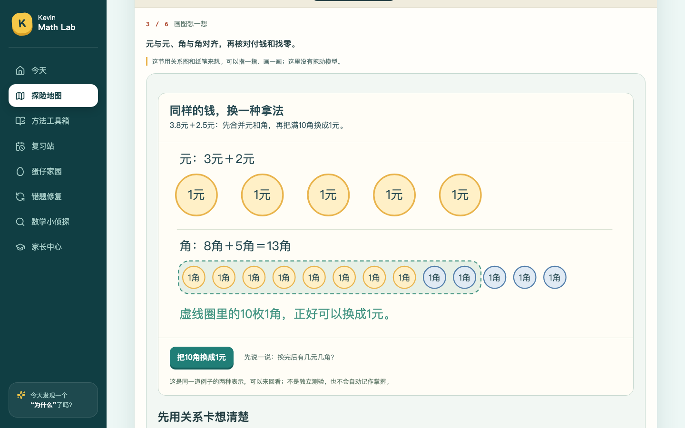
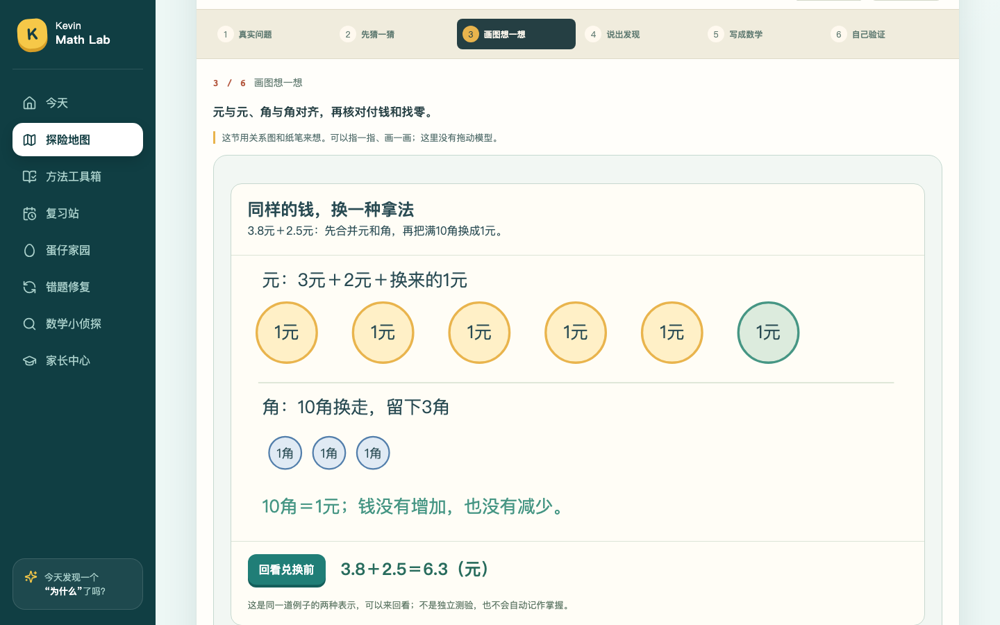
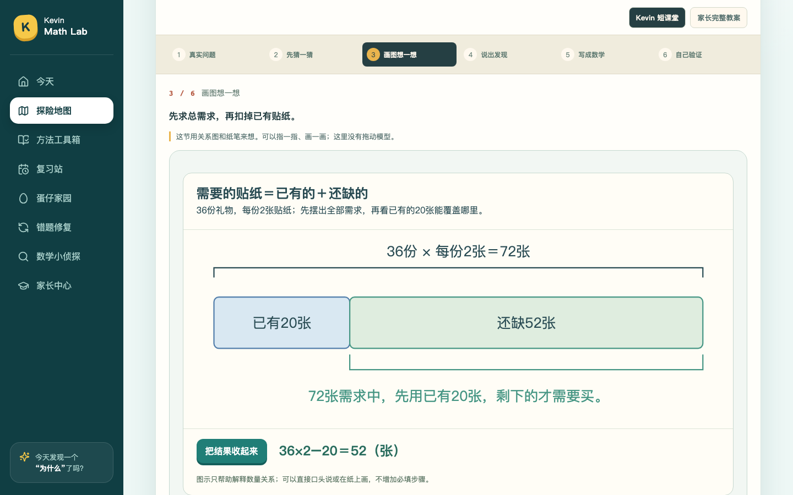
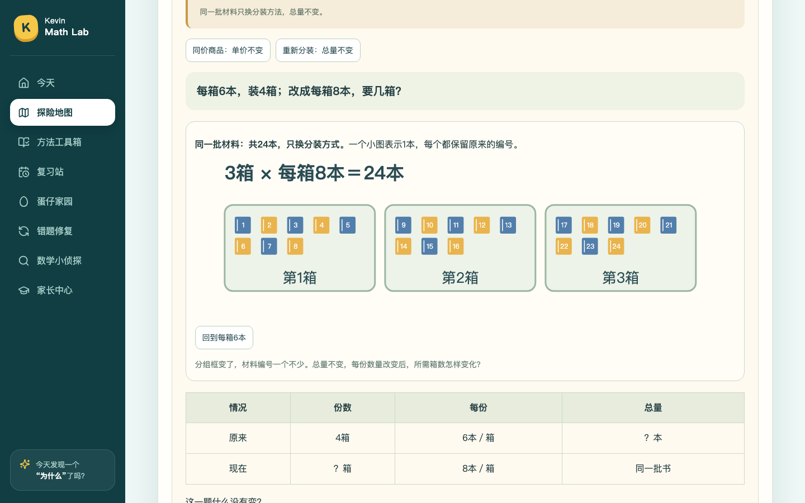
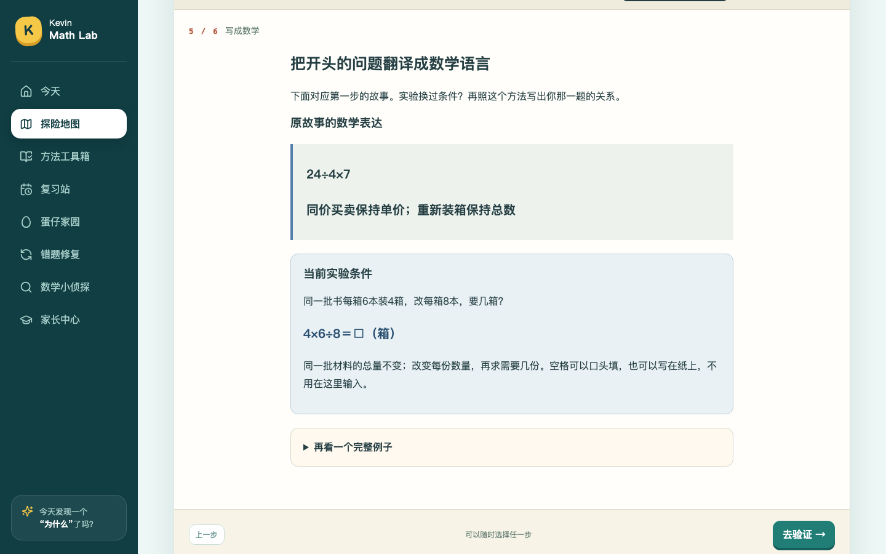

# 三年级其余课程视觉与逆向：整改验收

依据：`三年级其余课程视觉展示与逆向思维_全面复审及Codex整改意见_20261019.md`，任务书提交281fe75，源码基线3a8ecae。链环设计冻结；不修改Kevin真实数据、首答、三项自查、奖励与849个正式任务身份，不合并main。

## A：证据映射与CI失败

在干净281fe75运行`node --test tests/teaching-semantic-ledger.test.mjs`，7项中1项失败。进一步直接调用生成器核实：**desktopMath=70、fullPaths=64、staticRelations=6、visualInspected=69**。审计把同一行多个断言中的69误归到desktopMath；实际缺失的是G3-U03-E02章节补测中`visualInspected`标记，并非70课数学证据缺一课。保留原失败记录，不降低任何测试期望。

- 已逐张查看948a557归档的链环故事、猜想、初态、操作后、追问、数学表达、练习入口7张图；补充日期、图态和代理审查记录，不覆盖原SHA或更名截图。
- 证据选择改为先验证成功/干净/当前内容指纹和操作类型，再从有效候选中确定性选择；精确指纹优先于经题库专项审查允许的历史兼容记录。失败、脏、旧指纹记录不能因为位于数组前面遮挡有效记录。
- 增加数组换序、旧版本、失败、脏工作树、重复回放、多个有效来源的回归。专项8项全部通过，台账70/64/6/70恢复。此为技术与代理看图记录，不代填家长或孩子掌握。

## 后续实施范围

B：修混合运算A/B指令和场景标签、扫描其他多场景关系。C：元角兑换、上册复习数量条、固定总量分组3个原型及平移小修。D：已有11道逆向任务与逆推课堂的可追溯索引，不新增重复任务或奖励。最终记录真实测试、截图来源SHA与最新CI；未完成前不宣称本轮全部验收。

## B：完整故事与当前情境

第3屏任务从`shared/scene-context.mjs`按当前场景生成，第1屏和第5屏仍明确属于原故事。G3-U02-B03：A为12颗＋8颗再每4颗装盒，B为原有12袋＋散珠装成的新袋；场景标题不再把内部taskMode的A/B当作场景编号。G3-U02-B01切到标签装盒时也不再命令解释车上人数。

同类扫描覆盖70课、134行情境。11节核心课66组操作的顶层使命不再固定147×8、8个区、3200元或八分之一；表述从当前数学关系与单位生成。六步语义台账同时区分原故事使命与运行使命，逐场景矩阵另列问题、单位、图形模型、算式和解释。源扫描不是逐张人眼审定69课。

## C：三个视觉原型与一项小修

- G3-L06-B03：同一道3.8＋2.5示例的两种表示；5元＋13角中圈出10角，按需换成1元，得到6元3角。最终结果只在揭示后出现。保留静态关系课分类，确定性示例不冒充可变数学测验。
- G3-U07-R01：一条需求条分为已有20张与还缺的一段，按需揭示72总需求与52缺口，只出现一条综合算式。
- G3-L02-B06：同一批材料每个对象有稳定编号；4箱×6本可切换为3箱×8本，保留总量24，支持六组既有参数、撤销与刷新。单价不变的商品场景不显示重新装箱图，第六组米的单位与标题独立。
- G3-L01-B02：加粗主箭头，保留原位置虚影，补平移虚线路径与旋转扇形方向。操作按钮和数学状态不变。

下册综合复习数量链暂不扩做：本轮按任务书只选上册复习作为原型，待真实试学反馈再决定另一课。线段/射线/直线、图形分类、面积与周长仍保留准确静态图。连续进位与分割面积的长页面暂不重做，避免破坏已有教具；本轮只修其有证据的顶层情境错配。链环、木板与立体观察设计冻结。

## D：已有逆向任务可检索

复习站的可折叠索引精确引用11个原任务，另链接G3-U02-O01逆推课堂；相关题卡仅增加方向与未知量标签。索引不展示数值答案或具体解题式，原提示/参考过程仍走已有辅助留痕。家长文档列出每题原题组与正向代回核验；不新增题目、会话身份、奖励规则或学习步骤。

本轮不追加5～6道新题：现有11题已具备数学及正式流程验证，先修检索与教学展示，不为扩张数量改动849题。两个开放解释任务保留家长批阅，不凭自查勾选判掌握。

## 验证进展（最终归档前）

223项Node测试、构建、内容检查已通过。新专项已在临时数据库完成A/B/A实际运算、错误第一步、撤销、刷新、3个图示、六组分装与11个原题链接；最后加入标签后将以干净功能SHA重跑并归档。真实学习库未读取或修改；本节不是最新PR CI通过的证明，最终SHA与CI链接待下方补充。

## 第5步衔接补查

逐段review又确认G3-L02-B06的当前实验表达在总量模式下仍引用ctx.story（买本子的单价条件），通用说明还会把单价和总量不变混说。现改为按当前mode取ctx.story／ctx.alternate，分别显示单价路径与总量路径的空白算式；六组参数均验证price→total→price和刷新。正式题、版本、积分与学生首答不变。此修订单独取证，不把之前截图冒充修正后的第5步。

## 最终本地验收与固定来源

|范围|固定来源|真实结果|
|---|---|---|
|证据选择与缺标记修复|2cb0c56|保留70课期望；指纹/失败/顺序/回放专项通过|
|主要图示、场景指令、11题索引|be37be9；模板断言修订afb9e8a|224项测试中的初始223项通过；首轮本地6组浏览器全部通过|
|17课完整数学路径与截图|afb9e8a11af2a69885141b53551aa7b1797bb901|17节全路径、70课六步/三勾、17章代表语义、原链环及11课核心数学回归均通过|
|归一/归总第5步补修|68233965bf401dac5328f8b43d18e9a8e352f397|最新224项Node全部通过；TypeScript/Vite构建通过；新增专项与B06桌面完整路径通过|

首轮6组：[来源及文件哈希](evidence-remaining-visuals-20261019/manifest.json)、[摘要](evidence-remaining-visuals-20261019/ci-summary.json)。其数学路径截图按17课回填，其余53课保留原来源。代理新看图只针对改动的第3屏指令/当前条件及3个重点图示、平移旋转；不声称本轮又亲眼逐张核准全部69课的全部六屏。

B06补修另存：[来源及哈希](evidence-invariant-context-20261019/manifest.json)、[专项结果](evidence-invariant-context-20261019/verify-remaining-visuals-browser.json)、[单课完整路径](evidence-invariant-context-20261019/verify-desktop-semantic-browser.json)。B06在台账中采用新来源，其他16课仍是afb9e8a，不把旧图重命名为补修后验收。题库70/64/6/849、17张开放思维卡/43张暂缓的口径均不变。

远端发布验收只认[PR #1最新head的Checks](https://github.com/lovestream/math-learning/pull/1/checks)，不能拿948a557成功的旧运行或afb9e8a被取消的运行冒充当前通过。最终工作流固定链接与head SHA由PR说明记录，归档文件保留各次实际取证SHA，避免为了自引用反复改写报告。归档后不再增加功能；若最新CI失败，仅修失败本身。

### 3个重点图示实际画面（1440×900）

[70课134行情境矩阵](三年级逐场景语义一致性矩阵_20261019.json) · [11道逆向任务＋1节逆推课堂清单](三年级现有逆向练习索引_20261019.md)。

### 保留与待真实试学事项

- 849题、课程/题目内容版本、首答、自查三勾、积分和学生数据库均未修改；本轮仅用合成临时数据。正式逆向题沿用原任务和判分/家长批阅，不凭索引点击或示例揭示记掌握。
- 下册复习数量链、连续进位/面积的进一步折叠和最多6道新增逆推题按前述理由暂不扩做，不是本轮P1阻断项。四至六年级、43张暂缓卡、统一Learning Website的长期问题不变。
- 图示技术验收不等于Kevin理解；建议试学元角兑换、固定总量重新分组和B03两种单位关系，观察能否指图解释并隔日独立迁移。
- 已复查代码diff、数学不变量、失败路径、撤销/重置、刷新、现有逆向题的无答案图与正式首答/订正流程。仅向原PR分支提交，未合并main。
