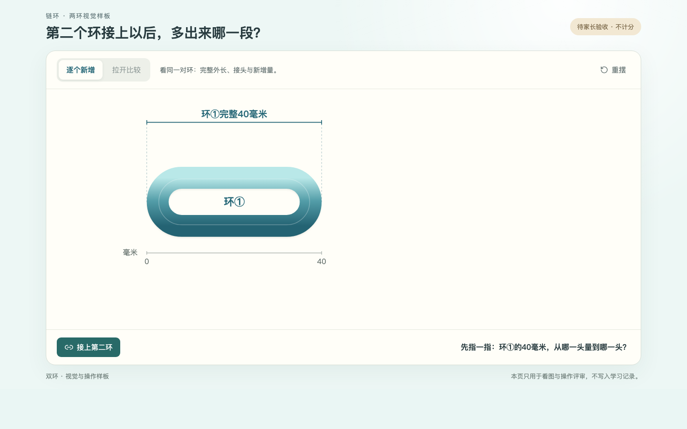
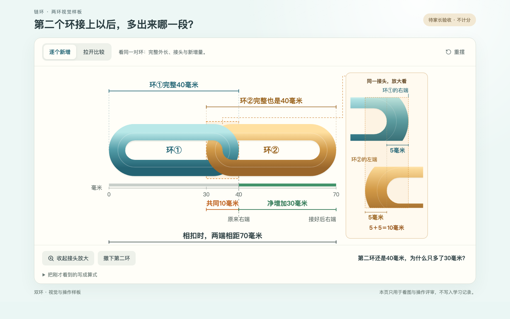
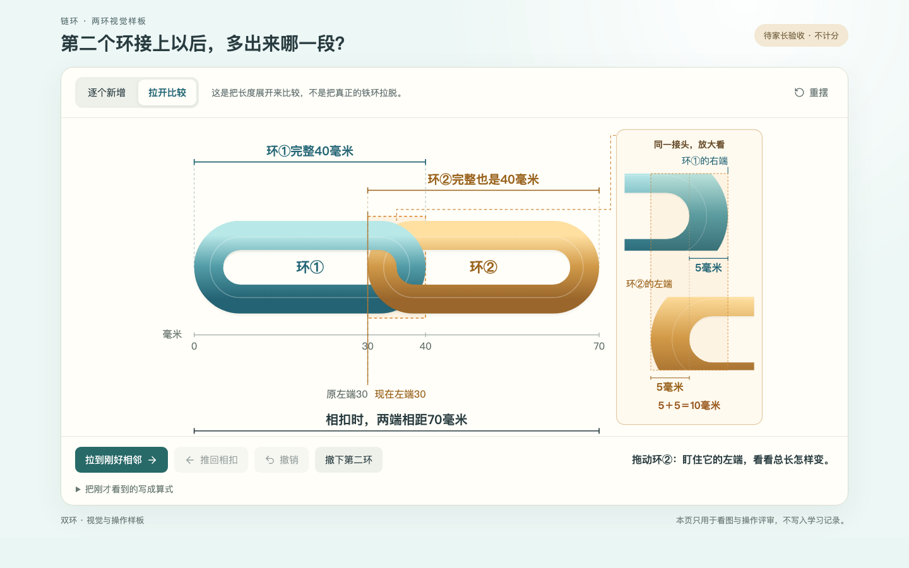
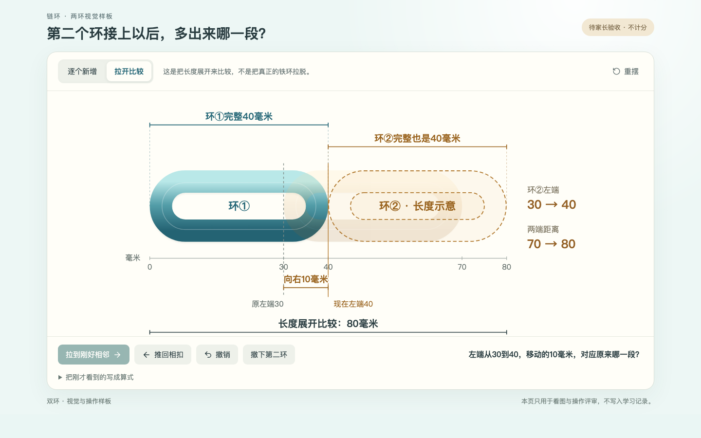
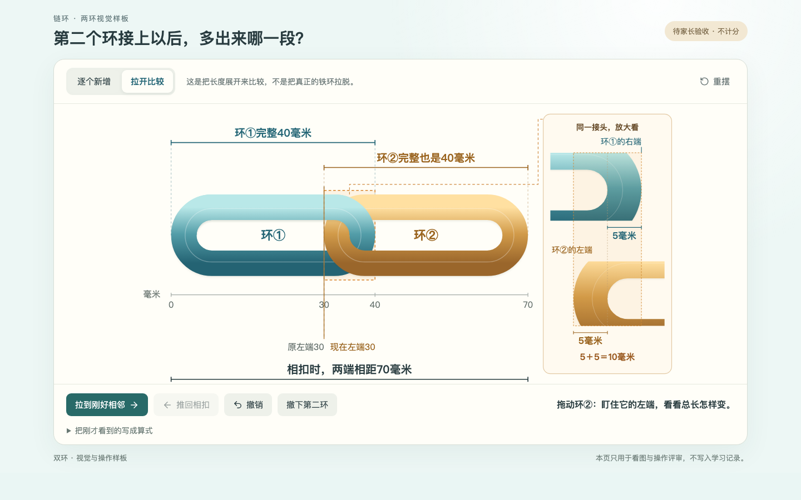

# 双环样板：端点标注修正与聊天截图

> **2026-10-19后续确认：** 家长已批准修正标注版双环A–E。按最新§2.6，现已完成[正式课堂接入与极简多环概览](链环课堂_多环概览正式接入_20261019.md)。双环批准仅限视觉；三至五环待家长看新图。下述待审／暂停状态及旧截图保留作历史，不撤改原始证据。

2026-10-19。家长确认双环整体效果很好，指出放大图“环①的右端”文字位置不对，并要求直接在聊天里显示其余画面。

本轮仅将该标注的右缘对齐放大框**最右侧虚线**，加一条短引线；不再与“环②的左端”放在同一左侧位置。环本身、5毫米端部、两种观察方式、六步课堂、三项自查和真实学习数据均未改变。

功能SHA：`c246c098e4df7ad68f94fd41f5582caea3d5127c`。构建与双环专项浏览器回归通过；补充右端标签必须对齐框右界的断言。下列五幅1440×900图片均来自此干净提交，准备在聊天内直接展示，不要求家长打开本地Markdown。完整双环效果仍待家长看完其余画面确认，本轮未扩展至三／四环。

[原阶段0记录](链环双环样板_阶段0实施与验收记录_20261019.md)保留c81ee7a的历史截图；本轮更新证据见[清单](evidence-chain-two-label-20261019/manifest.json)与[浏览器结果](evidence-chain-two-label-20261019/verify-two-ring-browser.json)。

## A：首环40毫米

## B：接上第二环；蓝色右端文字已对齐最右虚线

## C：拉开比较起点，左端30、总长70

## D：刚好相邻，左端40、比较距离80

## E：推回相扣，回到70

