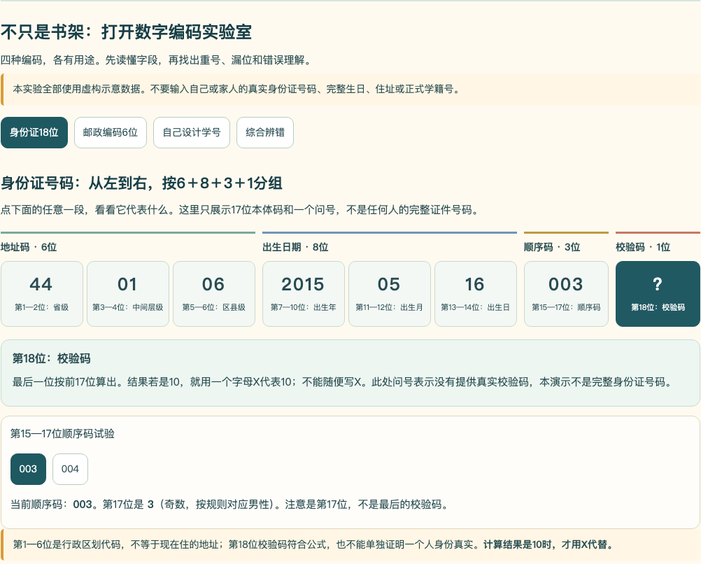
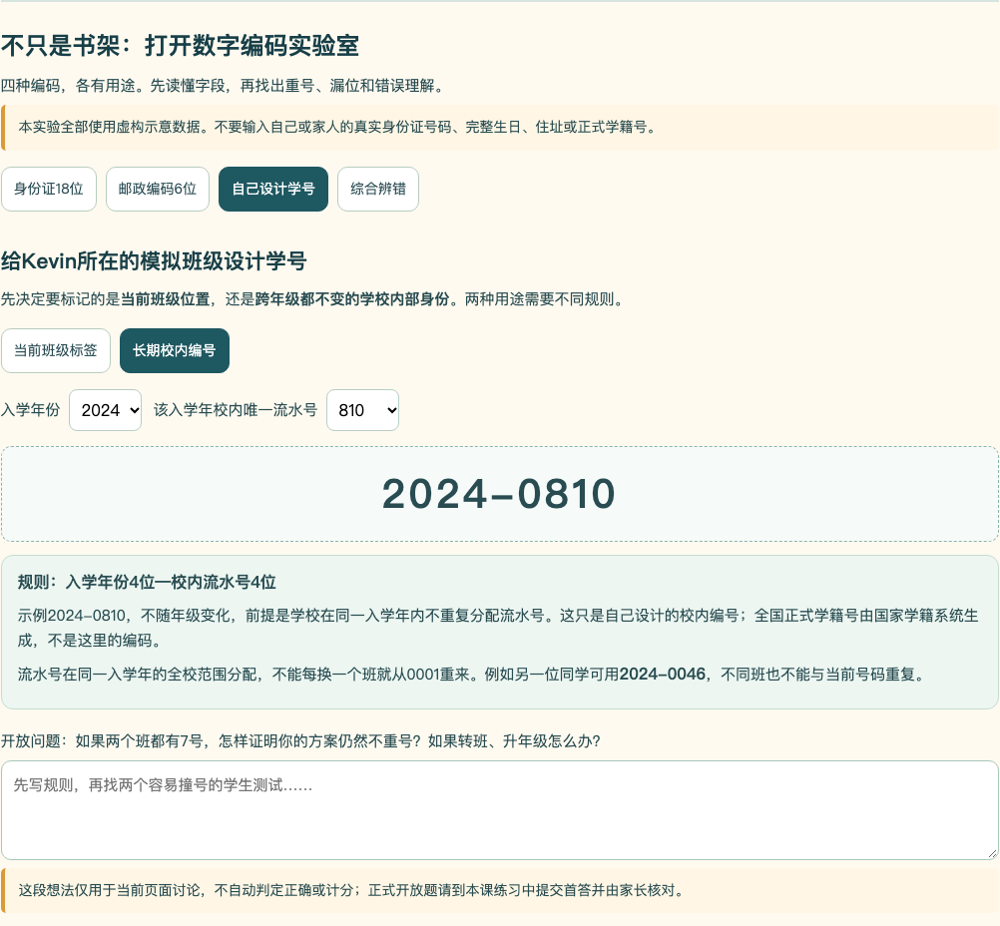
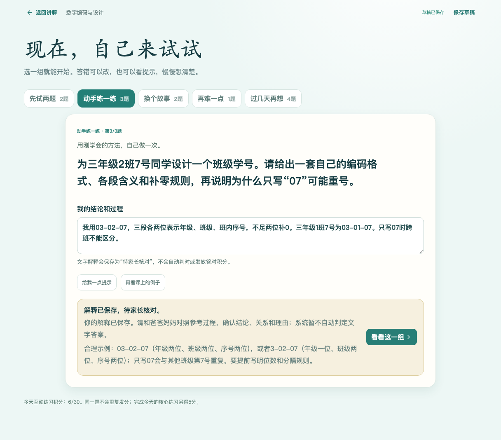

# 数字编码单元：实现与验收报告

验收启动日期：2026-11-08；报告生成时间：2026-11-09T00:22:13.265841+08:00。任务基线：`4fd7fb9c0693b6a045418c509f212aa90907d068`；本轮干净工作树受测源码：`03dddce275b50c813a88d86f600003018dba4f2b`。原始任务见[教学设计、实现与验收清单](数字编码单元全面扩充_20261101_教学设计实现与验收清单.md)。

## 结论与范围

`G3-UP02-B01` 数字编码课的工程整改、12题版本审校、六步浏览器操作、备份恢复与本轮代理截图检查已完成，可交家长复核和Kevin试学。课程版本为 `2026-11-01.2`。这不是Kevin掌握认证，也不是家长教学批准。

仍为70课、849道正式题ID；本课12题换版本，其他69课的编译内容指纹和台账整行保持不变。六步课堂和三项自查保持原样。未修改真实学习库、PIN、正式服务或NAS，未合并main，PR #1继续Draft。

## 一、问题与落地修改

|原问题|实际修改|验证方式|
|---|---|---|
|故事与猜想只有旧书架范围|四种条件卡并列展示书架、身份片段、邮编、班级学号|六步×3视口；四种可见条件图断言|
|身份证四组标签与实际分段容易错位|同一数据源建立6/8/3/1父组，再在地址码、日期码内细分；每段可点|8段说明逐一定位、003/004、第17/18位区分、3宽度裁切检查|
|第3—4位、地址码、X可能被过度概括|说明中间行政层级的特殊性、号码不等于现住址；X仅表示规则中的校验值10|课程文字与新题逐条审校、错误选项依据|
|邮编和身份证6位容易混淆|2/1/1/2邮政分段，和行政地址码并排对照；邮编不能代替详细地址|4段真实操作及条件对照截图|
|自编学号只会给一个固定答案|比较班级标签与长期校内编号；字段补零、跨班重号、升年级与毕业边界；稳定流水按同入学年全校分配|1,620个班级标签、39,996个跨年稳定编号唯一性/解码测试；无效输入拒绝|
|新题继承旧图、旧四位学号标准|12题移除旧配图；5道开放题各用本题专用3项核对标准，接受不同可解码格式|逐题新审校、P07真实输入与家长批阅|
|数位题题干自己给出18|P09只列6、8、3、1，独立算总字符数，问号仍占一位|题干无18断言；17错误、18正确|
|旧审校/旧掌握与新版混用|旧849历史原件封存；显式追加12题审校；新会话用新版本，旧首答/提示/结果/奖励保留|旧版及扩充初版到新版、导出还原、旧核心不拼新版掌握、同ID不重复奖励|
|旧全课/图形验收器误报编码故事缺图|对可访问的“四种编码的条件示意”组检查可见性及4个实际code条件|全70课六步回归与CI通过；其他图形检查保留|

身份示意固定为教学分段，以 `?` 结束；没有要求孩子提供真实身份号码、生日、住址或正式学籍号，也没有提供完整证件/校验码生成器。所有讨论示例均声明为虚构或模拟。

## 二、课堂怎样走

1. **真实问题**：先看到四种数字用途及对应条件。
2. **先猜一猜**：沿用已有选项/可选口述，判断编码和数量的区别。
3. **亲手实验**：身份分段点击、奇偶比较、邮编分段、两种校内编号、5个辨错的正误反馈与重置；原书架模型、撤销、重置和保存保留。
4. **说出发现**：选一种编码解释字段，再找“少写字段会重号”的反例，区分课堂编号和正式学籍号。
5. **写成数学**：对照字段长度、识别范围、6+8+3+1以及编号唯一性。原故事和切换后的实验范围明确区分。
6. **自己验证**：直接进入已有正式题组，首答封存后只勾三项自查，再提交；未增加强制填写反思。热身2题、核心3题、迁移2题、挑战1题、复习4题，共12题。

即时辨错、模型操作、讨论草稿均不算正式独立掌握或答题积分。讨论文本只作本页交流，不冒充已保存的正式答题证据；正式开放题需在练习页提交。

## 三、新版本12题审校与实际回放

|任务ID末尾|内容|方式|浏览器提交后、家长批阅前|
|---|---|---|---|
|P01|书架三字段表示位置|选择|正确|
|P02|可用编码的规则|选择|正确|
|P03|拆解给定虚构身份片段与日期|开放解释|待家长核对|
|P04|顺序码与第17位|选择|正确|
|P05|邮编用途及详细地址|选择|正确|
|P06|限定3年级×6班×45人自行设计|开放方案|待家长核对|
|P07|给3年级2班7号编码并举跨班反例|开放方案|待家长核对|
|P08|稳定校内编号、全校唯一性与正式学籍号区别|开放方案|待家长核对|
|P09|6+8+3+1的总位置数|数值|正确，18|
|P10|X与校验规则|选择|正确|
|P11|六位邮编的层次|选择|正确|
|P12|缺失字段、不同识别范围与校验局限|开放解释|待家长核对|

每题先保存错误/不充分首答，再三项自查后订正；12题首答均保留。5道开放题随后通过真实家长页面完成**合成测试批阅**及重复请求回放，不自动判对、不自动发积分、不追改首答；所有题组可完成并存在复习到期记录，完整导出再导入后的进度一致。完整输入/预期/结果见[acceptance-matrix.json](evidence-coding-20261109/acceptance-matrix.json)和[浏览器逐题报告](evidence-coding-20261109/verify-coding-browser.json)。

封存的[原849题审校](849题最终审校清单_20261009.json)字节SHA256仍匹配原件；[新增12题版本审校](final-task-review/versioned/coding-20261101.json)包含题干快照、全部选项及数学依据、开放可接受范围、旧证据指纹、官方来源和源码文件指纹。当前有效覆盖=原837条+新版12条=849，陈旧/未审校/错误均为0。这是**代理语义审校**，不是849题教师或家长逐题批准。

## 四、证据与回归结果

- `npm run build`、`npm test`（265/265）、`npm run content:check`（70课/849任务）通过；构建在测试之前执行。
- 本地 `node scripts/run-browser-ci.mjs --full` **32/32**通过，每组报告的source均为同一干净SHA `03dddce275b50c813a88d86f600003018dba4f2b`。包括新编码课、70课六步模板、原教材教具、侦探、思维卡、存档压力、独立小测、版本、正式题与家长审核流程。
- 新编码回调覆盖六步×1366×768、1440×900、390×844的18张课堂截图，以及分段、邮编、编号、错路、书架和批阅，共28张当前源码截图。代理实际抽看20张，具体名单及图片SHA256见[visual-review.json](evidence-coding-20261109/visual-review.json)。包括全部六步的代表画面和三个宽度；没有把未看的图片写成逐张教学批准。
- [源码CI（PR）](https://github.com/lovestream/math-learning/actions/runs/42497733112)、[源码CI（push）](https://github.com/lovestream/math-learning/actions/runs/42497726627)均成功，包含25组关键浏览器回归、构建/测试/内容校验、答案边界和三套升级/备份/回滚演练。32组是本地完整范围，25组是CI范围，未混用口径。
- 完整摘要、每组JSON与浏览器/服务日志、编码和家长审核trace、源码CI结果及文件清单均在[本轮证据目录](evidence-coding-20261109)。[manifest.json](evidence-coding-20261109/manifest.json)逐文件校验；[runtime-tree.json](evidence-coding-20261109/runtime-tree.json)记录受测运行文件的Git对象，用于与之后纯文档归档提交对比。

### 失败不是通过

上次 `d409a02` 的PR CI [41272134400](https://github.com/lovestream/math-learning/actions/runs/41272134400)实际失败于旧70课模板的图形选择器；该CI里的侦探验收已通过，不能把CI失败错归给侦探。本地更早曾有侦探超时，本轮专项及完整回放均通过，未臆造产品故障或绕过测试。随后 `765b302` 的[CI 42496641398](https://github.com/lovestream/math-learning/actions/runs/42496641398)和本地完整回归在UTC+8接近午夜时暴露了另一个测试边界：夹具加16分钟恰好跨天，新的每日计划是正常行为，原“同日计划不变”断言却误用。修复仅在隔离测试中把起点锚定为同一业务日正午；两条新测试覆盖全天1,440个运行时刻，以及真实跨天应新增计划并保留旧计划。生产时钟、出题和Kevin数据没有改动。再对后半段脚本做源检查时，发现`verify-intro-visuals`仍只识别旧图形，`verify-final-tasks-browser`仍把新版混合题型当全是文字题；已同步到四种条件图和P03解释/P04选择/P07设计的真实流程，分别针对性回放后再冻结最终源码。中途停止的全量及取消的CI不计通过。旧运行、旧截图、取消的运行均不充当本轮通过证据。

### 台账回填

先保留[69/70待验收快照](final-task-review/versioned/coding-20261101-pending.json)，随后才按本轮干净SHA和真实新截图给编码课追加证据。现在[70课语义台账](三年级70课_六步教学语义台账.md)为70条技术证据、64个完整操作路径、6节合理静态课、70条代理看图证据，家长教学批准和Kevin掌握仍为0。其他69行及各自旧SHA逐行保持不变。

[逐场景语义矩阵](三年级逐场景语义一致性矩阵_20261019.json)为70课139行情境：编码课明确六个源场景，其余69课不变。该矩阵是源扫描/数学核对，不冒充逐场景独立视觉或亲子教学验收。旧编码行与原始课堂证据保存在[历史文件](final-task-review/versioned/coding-20261101-history.json)。

## 五、来源边界与待家长验证

核心知识依据与URL保留在原始设计清单、新版本逐题审校和[来源核验记录](final-task-review/versioned/coding-20261101.json)。公安机关的号码组成、审计机关第17位/校验解释、国家邮政局和新华社的邮编说明、教育部正式学籍规则交叉核对。GB 11643-1999现行状态另经国家标准官方索引核对；教育部原文直连存在跳转，本文对其使用的是官方索引的第八条，不声称下载核对了所有条文。上海民政旧链接不可访问，未把它作为唯一依据。

本轮任务范围内没有已知未完成的工程项。尚未完成的**教学验收**是原清单的8个亲子问题：第17/18位、地址码含义、日期补零、X、邮编与个人身份、跨班重号、升年级稳定性、校验的证明边界。需要Kevin亲口解释和找反例，再根据真实卡点修订；机器不能代答。

未做真实iPad试学或新部署。长期统一Learning Website、其他年级、43张暂缓思维卡和奖励系统不属于本轮。仓库中的现有长期事项也不因本课通过而被标为完成。

## 六、实际页面

身份字段与校验位置：

长期校内编号，流水按全校范围分配：

P07接受可解释的编码方案，由家长审核：

