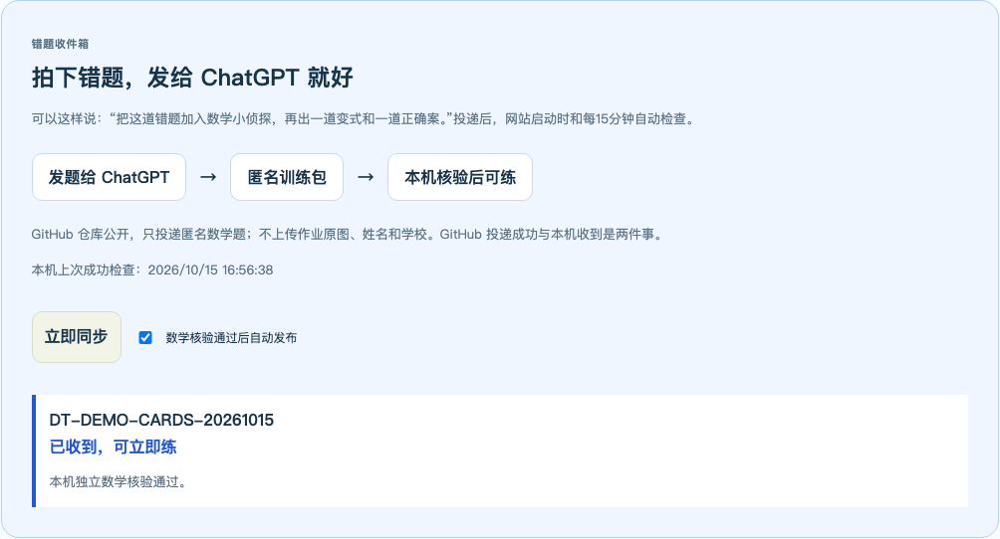
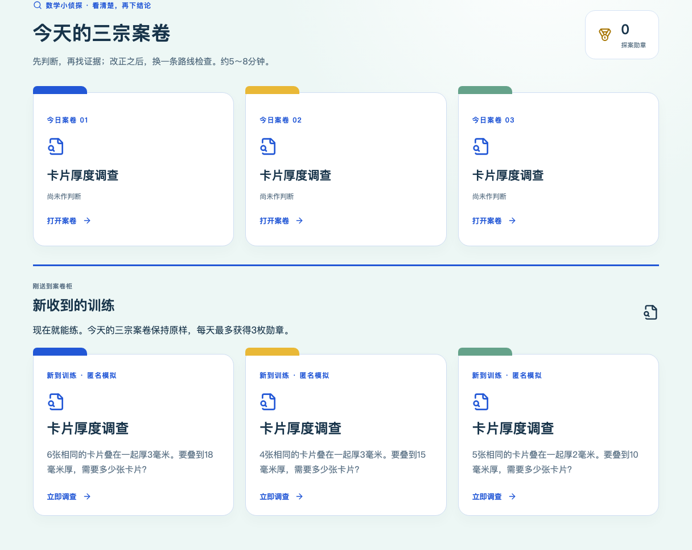
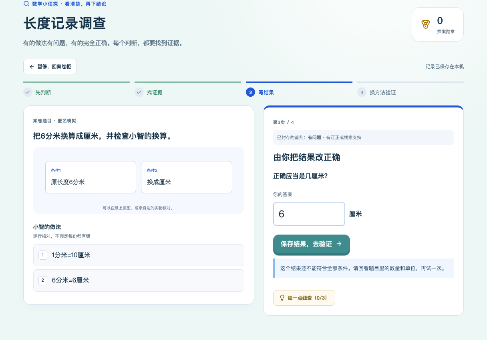

# 数学小侦探 V1.1：ChatGPT直投链路实现与验收

日期：2026-10-15（Asia/Shanghai）。范围：PR #1，`audit-fixes-20261002`。未合并main，未读取、编辑或恢复Kevin真实学习库。

## 版本与结论

最终功能代码：**`1ac14c25f7825c63764fec78b7e11e1bd98edf75`**。后续提交只收录说明、截图和本报告；不把旧main当审阅基线。

已实现“ChatGPT连接器实际写GitHub → 固定分支只读接收 → 独立数学核验 → 本地发布 → 新案立即打开”。家长不必为受支持题型填表或三勾发布。保留原四步侦探、手工后备、首判、版本、徽章、PIN及备份。

本轮实际投递的是**明确标记的匿名演示训练**，没有收到新的Kevin作业照片，因此尚不能把它称为“Kevin新照片的三方真实使用验收”。本机已收到的事实由网站私有同步回执核实，不仅凭GitHub提交推断。

## 真实GitHub投递与本机回执

- 创建数据分支：`detective-inbox`，从需求基线`e2f2182`建立；不合并此数据分支的旧应用源码。
- 通过已连接GitHub的`create_branch`和`create_file`工具实际写入。
- 投递文件：[DT-DEMO-CARDS-20261015.json](https://github.com/lovestream/math-learning/blob/detective-inbox/content/detective/inbox/DT-DEMO-CARDS-20261015.json)。
- 数据提交：[`36454da807b343ee0e7ce4136d18c6539c21f13a`](https://github.com/lovestream/math-learning/commit/36454da807b343ee0e7ce4136d18c6539c21f13a)。
- 源blob SHA：`e640f2ca22c08bc960a164fdcc17e4822536623f`。
- 三案：6张共3毫米目标18毫米→36张；4张共3毫米目标15毫米→20张；5张共2毫米目标10毫米→25张（正确对照）。
- 实际本机状态：`auto-published`，3案，`detective-oracle.v1`。
- 本轮最后一次真实回执、截图与浏览器新案验证绑定干净功能SHA `1ac14c2`。见[回执JSON](evidence-detective-inbox-20261015/detective-live-inbox.json)。
- 已将精确契约、开发指南、参考数学渲染器、生成器和明确标记的fixture初始化到数据分支，供后续ChatGPT读取。网站只读取inbox数据JSON，不执行分支上的JS。

## 原行为 → 新行为与不变量

|原行为|新行为|不变量|
|---|---|---|
|家长逐字段录题、发布|默认聊天发题；网站自动收取支持模板|手录仅折叠备用；原稿与作答不删除|
|JSON字段完整即可|严格契约＋独立推导完整数学内容|不相信producer、自报答案、approved或confidence|
|只能启动今日三案|新收到案件可立即调查|已有今日2错1对及版本不替换；原徽章每天≤3枚|
|家长三勾发布|自动导入有独立审核来源|`deterministic-import`与`parent`区分；不伪造家长操作|
|远端重写可能重复|blob增量、包幂等、逐案内容去重|字段重排不重复；不同包共用相同当前题也复用；不复用已经改题的旧版本|
|手工草稿修订号随列表变化|编辑时固定所见修订号|后台同步后，旧编辑不能带新修订号覆盖新内容|
|来源只在聊天中|私有导入台账和版本来源|分支/路径/blob/包hash/题hash/修订号/导入时间/oracle/处置均保存|

## 数学准入与隐私

自动支持五类审定模板：卡片厚度分组、加乘/减除顺序、长度换算、等组数量、长度排序。它们逐字段校验题干、模拟步骤、首错、依据、三层提示、修复、逆查、单位、图和解释；不是将AI答案复制成expected。

模板拥有明确参数范围，拒绝不整组、除法不整除、错误顺序恰好同结果、排序同长等含糊构造。卡片变式使用随参数变化的条件图，未套用固定3张/2毫米旧SVG。

未知模板整包存为私有待核对；已知模板存在数学矛盾整包拒绝。暂停自动发布或已撤回的案不被远端自动放回。家长可从收件记录打开待核对稿，确实核对后才走原发布流程，来源明确为parent。

拒绝超长、重复/原型ID、额外字段、HTML/链接/私人来源等；这些拦截不能代替投递者先脱敏。本轮公开演示没有原图、孩子姓名、学校、班级、学号或私聊全文。普通`/api/data`、`/api/studio`继续删除整个私有侦探namespace；儿童案件按阶段隐藏答案、错行和来源。公开GitHub本身不承诺题目答案对主动浏览仓库的人保密。

## 同步、存档与安全

- 服务启动自动检查；后台每15分钟检查；进入侦探页距上次检查超过2分钟时异步检查。页面定时更新列表，正在调查的版本不跳题。
- 固定仓库、分支、目录；索引ETag；只下载变化blob；限192KiB/文件、400目录项，并核验Git blob SHA。
- blob API限流时仅从固定GitHub原文件路径后备读取，仍须匹配索引SHA；目录API不可用则等待，不绕过来源校验。
- GitHub不可达/限流/超时：本地案卷保留，1/2/4…分钟退避、最多6小时，并遵守目录API的限流reset。家长看得见错误和下次重试。
- 单包事务；任一已知数学错误不发布半包。某包失败不清除旧记录，也不阻塞其他合法包导入。
- 200案、20版本/案、1000调查、3MiB侦探上限及studio总容量限制保留。满容量明确拒绝，本地历史与GitHub原件不丢。
- PIN保护同步状态、立即同步和自动发布开关；POST延续同源检查；无公网写接口或前端token。
- inbox台账、待审稿、原案版本、作答与徽章纳入现有备份。旧版无inbox字段继续兼容，未来未知版本拒绝，不静默清库。

## 验证结果与具体证据

|验证|结果|证据/边界|
|---|---|---|
|Node全量|**189通过**|`npm test`，保留原178项；新增11组收件测试。临时HTTP测试扩展PIN、同源及设置保护。|
|数学参数|**96组**|五类模板，包含四则两种结构、正误两类及数值边界；篡改题干、解答、答案、首错会拒绝。|
|构建|**通过**|`npm run build`：TypeScript＋Vite。|
|原课程内容检查|**通过**|70课、849正式任务不变；59单元未来蓝图仍planned。|
|完整关键浏览器回归|**17组通过**|[完整摘要](evidence-detective-inbox-20261015/detective-inbox-full-browser-summary.json)。该轮开始于需求基线＋工作区改动，逐项source记录保留，不能伪称均从最终干净SHA开始。|
|最终干净功能SHA侦探复跑|**3组通过**|[自动收件](evidence-detective-inbox-20261015/verify-detective-inbox-browser.json)、[原手工/四步探案](evidence-detective-inbox-20261015/verify-detective-browser.json)、[断网/409/恢复](evidence-detective-inbox-20261015/verify-detective-recovery-browser.json)，均绑定`1ac14c2`且dirty=false。|
|真实GitHub读取与浏览器回执|**通过**|同一最终干净SHA；使用独立临时服务及数据目录，非伪GitHub。见上方真实回执。|
|视觉检查|**通过所测样例**|390/768/1440、错误修复反馈、真实新案和收件回执。窄屏标题竖排问题已修正并加宽度断言。|
|Kevin新照片/真实教学|**本轮未验证**|没有新照片输入；不以演示或技术测试宣称孩子掌握。|

新自动收件浏览器测试：模拟GitHub目录→启动收到首包→网站保持运行→测试时钟推进16分钟后自动收到第二包→今日计划不变→计划外新案立即打开→首判/首错证据→错误结果不能通过→修复→逆向验证→原首判保留→PIN状态→重复拉取幂等→备份和钱包不变。生产代码没有假收件写接口；模拟只通过显式Node测试预加载器注入，不读真实学习库。

关键Playwright套件已纳入PR CI，现为17组；本地可选完整列表24组，**本轮不声称24组都重跑**。每次CI产物绑定实际PR head SHA，见[PR检查](https://github.com/lovestream/math-learning/pull/1/checks)。本报告写入时新head CI尚待触发/完成，不能拿此前8c11afb的CI绿灯冒充本次结果。

[390px收件页](evidence-detective-inbox-20261015/detective-inbox-parent-390.png) · [390px新案柜](evidence-detective-inbox-20261015/detective-inbox-arrivals-390.png)。这些均是匿名临时测试内容，非真实学习记录。

### 已发现并处理/记录的失败

1. 新浏览器脚本曾在页面仍是修复阶段时向旧输入框填入验证值，随后转换阶段清空导致等待超时；脚本改为等待验证阶段，再填答案。未靠任意延长sleep隐藏问题。
2. 实际GitHub匿名API曾返回403且额度为0。失败被记录，未宣称已收到；补充受SHA约束的原文件后备后，另用真实临时服务取得成功回执。目录API限流仍按规范等待，不能保证断网时固定15分钟收到。
3. 浏览器截图发现新案卡少了占位图标，导致390px标题进入40px列；已补齐图标、截图复查并增加标题宽度断言。
4. 最后代码检查补充家长旧草稿修订保护、已审稿队列更新，以及跨包部分同题的去重/当前版本匹配；有对应回归，不反复奖励同一数学题。

## 修改文件清单

- `shared/detective-inbox.mjs`：严格包契约、五类数学oracle、规范化指纹与来源/备份校验。
- `server/detective-inbox-store.mjs`：事务导入、逐案去重、版本/容量/待审和来源台账。
- `server/detective-inbox-sync.mjs`：固定GitHub只读同步、ETag、SHA、限流后备、退避和调度。
- `shared/detective-model.mjs`、`server/detective-store.mjs`、`server/index.mjs`：可选存档扩展、新案入口、明确审核来源、PIN与后台生命周期。
- `src/detective/ParentDetectiveCases.tsx`、`DetectivePanel.tsx`、`api.ts`、`detective.css`：聊天发题入口、收件状态、待审直达、备用折叠、新案立即练与编辑冲突保护。
- `scripts/create-detective-bundle.mjs`、`scripts/fixtures/detective-inbox-fetch.mjs`、`verify-detective-inbox-browser.js`、`verify-detective-live-inbox.mjs`、原侦探浏览器脚本与`run-browser-ci.mjs`：生成、隔离测试、真实网络验证及CI整合。
- `tests/detective-inbox.test.mjs`、`tests/detective-http.test.mjs`、`tests/fixtures/detective-inbox-v1.json`：数学、事务、同步、权限、版本、兼容与奖励边界。
- `.github/workflows/verify.yml`：应用PR继续验收；纯数据分支不为每题触发整套应用构建。
- 收件README、JSON Schema、开发指南、家长说明、项目README、本报告与匿名截图证据。

## 使用与未实现边界

重新双击`start.command`构建并重启本机新版服务；以后每题只投递JSON，不必再找Codex构建。完整使用见[家长使用说明](../数学小侦探_家长使用说明.md)和[ChatGPT投递指南](../design/数学小侦探_ChatGPT投递开发指南.md)。开发验收服务均临时隔离，未重启或写入真实学习服务。

仍需明确：

1. 真实新照片的识题/澄清/投递需在有GitHub写权限的ChatGPT对话中进行；当前对话未提供新照片。连接器失败必须如实报告，不能假称投递。
2. 本机没有向ChatGPT上传回执或学习统计的通道；ChatGPT只能报告已投递，实际是否收到看本机。
3. 开放解释、估计、复杂几何、任意括号算式、分数等超出本轮五类模板的内容不自动数学证明，留待核对/后续扩展。
4. 不做网站OCR、原作业图片保存、NAS、公网部署、正式错题自动转案和个性化间隔复习扩展；四至六年级、70课/849题、六步课堂、三项自查、思维卡和原积分宠物均未改。

阶段1的软件链路和匿名真实投递联调已具备使用条件；这不等同于Kevin真实作业照片、亲子试学或独立掌握验收。
