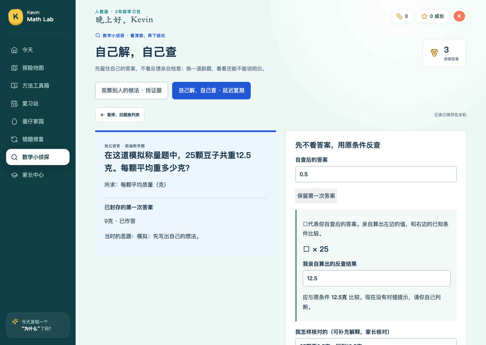
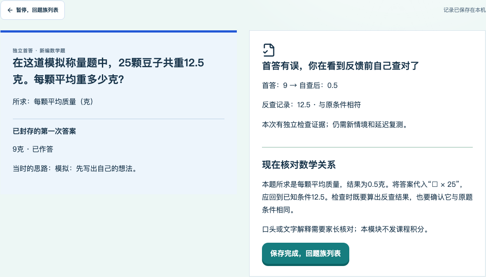
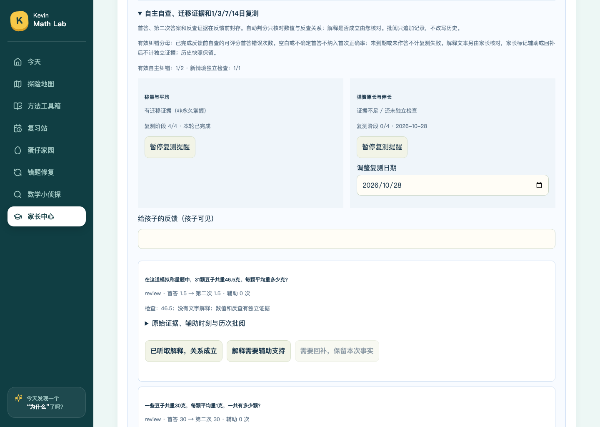

# 数学小侦探 V2四层训练：最终实现与验收报告

> 需求基线：Issue #3及4da0e4ba46f7c2448c201ef69401a4728b8dd217中的一次性交付任务书。
> 测试源码：58e9faec79b9ce6acf0062b9d8882ebc2f0b9681，工作区干净。
> 匿名数据HEAD：8a9bd699ba88385e9336590fe70a8b3ecec4bd85；固定blob见证据清单。
> 任务书内实现与隔离验收完成。受测源码的 [push CI](https://github.com/lovestream/math-learning/actions/runs/40499526376) 和 [PR CI](https://github.com/lovestream/math-learning/actions/runs/40499534787) 均已通过。最终归档提交的同SHA结果在PR Checks及唯一交付总结中另行核对。
> 所有作答为临时库自动化模拟，不代表Kevin真实掌握；未执行正式服务切换，未访问真实进度库。

## 1. 交付结论与范围

本轮只完善math-learning的数学小侦探：保留原四步判案，增加过程有效性判断、数学诊断、同类/正确对照/逆向和独立自查及延迟迁移。70课、849题、六步课堂、三项自查、原课程积分、宠物、PIN与原每日三案规则不改。未访问Kevin真实进度库；未修改kevin-learning-home、NAS或正式启动目录；不合并main。

源码、题库数学与技术验收是不同证据。下述通过结论不能推断孩子长期掌握，不能说家中Mac已经更新。

## 2. 原行为 → 目标行为 → 实现与不变量

|原行为/风险|最终行为|主要文件|数学/记录不变量|
|---|---|---|---|
|旧四步容易被误当四层能力|L1/L2保留judge/evidence/repair/verify；L3对照及换未知量；L4单独自答引擎|DetectivePanel、SelfTraining、detective-self-store|L4不预告别人有错，不复用judge首判代替自己的首答|
|正确/错误二值不能表达过程未知|三态中立选项对所有案一致显示；新增无效推理、未知过程、正确过程对照|process-cases、detective-model/store|80数值正确不代表20×4能说明总长；不编造真实中间步骤|
|分类可能猜测态度|6类可观察数学行为，首错、原步骤、依据、首证据保留|detective-store|前面正确步骤不修改；正确对照不计入错误类型频次|
|新四模板只会needs-review|oracle.v3：全字段确定性模板、12份审定文字版本、独立复算|detective-mass-spring、detective-inbox、delivery-audit|精确分数/定点；颗数整数；毫米/厘米一致；首错在真正错误结论处|
|未知模板被ETag永久跳过|旧v1/v2待审固定blob重验；编辑冲突稳定待人工，不挡健康包|detective-inbox-sync/store|不覆盖本机编辑、撤回、发布或旧首判|
|检查勾选不能说明自己查对|两次答案与具体反查计算固定后才反馈|detective-self-store、SelfTraining|首答不可改；不因勾选、看过解释或提交就判独立|
|未见题/逆向含糊|8族可控参数；每族240个自主参数，反向分支改变实际未知量|detective-self-questions|原例、对照使用保留参数；自主题不循环已见参数|
|提示可能混入独立证据|hint/visual/parent分开记时间和phase|self-store、self-integrity|辅助后仍能学习，但不算无提示迁移|
|反馈后资料改写历史|反馈快照封存；家长批阅只追加，更正不改首答/二答|self-store、ParentSelfTraining|当前证据资格与不可变历史分开|
|固定变式失败后循环熟题|seen记录；默认第1/3/7/14日到期提醒；可暂停/顺延|self-store|未到期、未做不算失败；每日同族最多推进一次；用完停止|
|自查和延迟测试支架混用|学习自查给反查操作；延迟复测撤预填式和自动反馈，自己写反查|self-questions/store|数值/标准逆关系由服务端核验；其他方法和解释留家长核对|
|升级可能覆盖旧进度|可选selfTraining命名空间；旧schema不重写，导入严校与旧checkpoint回滚|self-validation/integrity、store、upgrade脚本|不静默回填旧结果，不把新版库交给旧程序继续写|

## 3. 四层如何实际使用

### L1/L2：看懂、定位并证明

“观察别人的做法”保留今日三宗和新收件入口。首判冻结；证据需指向第一处可证明的问题与真实数量关系。新增三个审定匿名对照：答案80但理由20×4无效；仅有80而中间过程未知；60+20并反查正确。第三选项始终可见，不能靠按钮是否出现猜正确性。旧二值首判仍按原语义读取。

类型只含读题/对象、单位/量感、计算/顺序、数量关系/模型、表达/缺步骤、验证。首证据正确率只统计本版实际保存的首证据，不回填旧版首次状态；正确对照不作为错误频次。

### L3：同类、正确对照、真正换未知量

每族可打开一错一对的匿名对照，独立新题按参数生成。反向分支包括平均→颗数/总质量、总长→挂重/原长、张数→厚度、运算结果→加数、小单位→大单位、总块数→袋数、长度差→短绳长、绳长→缺少长度。题目数学来自同一受控条件状态，答案再以另一计算路线复核，不临时调用大模型生成未经验证题目。

8族×256审校参数的2048组关系通过独立解析/代回测试；其中每族240组供自主训练，其余作为保留审校/对照参数。不能把这些参数实验计成新增正式课程题、Kevin做过的题或新增积分。

### L4：首答 → 无反馈自查 → 二答/证据 → 反馈 → 延迟新题

首答状态明确分为已作答、仍不确定、空白；空白不能同时保留数值。初次思路可选。自查必须实际填反查结果，可保留或改答，并明确完成/仍不确定。第二次答案和证据原子封存后才评分，支持：第一次正确、反馈前自己查对、答案改对但证据不足、没查出、第一答对却改错、辅助完成、首答未评分。

服务端first/check响应不含answer/result/solution/正确性；延迟review连预填check关系也不发。标准答案和引擎不进入Vite客户端包。辅助条件图只重述当前已知题意，不夹带未知量答案。

自动检查只覆盖数值和本题限定的反向代入关系，不把关键词当数学证明；其他有效验证方法和解释保存后交家长核对。界面对此有明确提示，未自动核验不得谎称错误证明或独立掌握。

## 4. 四模板、12案与原18案

|包|数学模型|实际核验|
|---|---|---|
|DT-20261026-AVG-FOUNDATION-A|总质量÷实际颗数|0.6、0.5、0.5克；乘回总质量|
|DT-20261026-AVG-REVERSE-A|总量=颗数×平均；颗数=总量÷平均|24克、16颗、6颗；颗数整数且唯一|
|DT-20261026-SPR-FORWARD-A|总毫米=10×原厘米+载重×每千克毫米|80、100、92毫米；漏原长首错不标到正确乘法行|
|DT-20261026-SPR-REVERSE-A|重量=(总长−原长)÷增量；原长=总长−伸长|5千克、70毫米、7千克；按正向条件重建总长|

四份原JSON逐字节与数据分支固定blob核对，未改原投递文字来凑模板。审定文字版本须全字段/参数相同，仍另算答案、单位、首错；今后同模型新参数使用create-detective-bundle生成全字段，不必每题改React。未经审定复杂题仍待审，producer自述不能放行。

在线只读GitHub→本地自动接收→新案入口→全部四步：10包30宗通过，其中原6包18案、新4包12案；不计重复演示包。该结果仅限本次OS临时库。实际称量未知，10颗共6克等都是新编模拟数，不说成Kevin原作业实测值。

## 5. 统计、复测、家长工作台

统计携带numerator/denominator，分母为零显示样本不足：首次正确率排除空白和不确定首答；自查后正确率只含实际二答；有效纠错分母是已完成反馈前自查的可评分首答错误次数；同时列首答对却改错、新情境、1/3/7/14日独立复测和首次找错证据。

只有无辅助、数值与检验成立、明确完成检查的记录支持单次独立证据；同族需按时间先有自主检查，再有不同参数迁移，之后跨日新题复测，才显示“有迁移证据（非永久掌握）”。家长标辅助或回补后当前独立资格撤下，历史快照保留；明确回补会重开下一日提醒。

到期队列不挤掉普通每日三案，不要求今天全部做。家长可暂停、恢复或顺延90天以内的本地日期。固定Asia/Shanghai，跨午夜有测试；时间倒退超过5分钟或跳跃超过一年拒绝写入并保留记录。延迟失败保持阶段、次日用未见参数重测，不循环原题。

## 6. 状态、隐私和容量

- schemaVersion=1的旧侦探内容不重写；可选selfTraining.schemaVersion=1与engineVersion=detective-self.v1独立。错误/未来版本拒绝，首答指纹与结果、反查、题目版本、seen引用均复核。
- eventId相同重放幂等，不同负载拒绝；expectedRevision防409覆盖。首答、二答与反馈固定，草稿刷新恢复；断网保留输入并用同一事件重试，站内离开先保存，可下载未保存草稿。
- 家长接口仍用原PIN和同源保护。/api/data、/api/studio不带侦探私有命名空间；学生API只按阶段投影。公开数据仍无作业照片、笔迹、姓名、学校或真实学习记录。
- 自主最多1000次/2MiB，整个侦探仍3MiB、互动仍6MiB；1000条紧凑合成记录约1.10MB。达到容量拒绝新增，原子回滚，不丢历史；儿童只投影最近100条及未完成记录，家长和备份保留全量。
- 注入ENOSPC的备份写入失败、事务失败、超限、旧/当前/未来备份和损坏拒绝均有测试。完整回滚使用升级前checkpoint；新版记录另存，旧程序拒绝新命名空间，不能假装无损读新库。

## 7. 验收矩阵与证据

全部记录绑定上述测试源码；最终归档提交只增加报告/证据，不给旧截图改SHA。机器清单保留每个文件sha256，源文件树指纹证明最终PR运行实现与受测源码一致。最终head的自动结论另以PR Checks同SHA核对。

|任务书项|测试代码/输入|预期与实际证据|
|---|---|---|
|A范围冻结/旧流程|git diff与全部旧默认测试|70课849题、课堂/积分/宠物等文件无改动；无真实库|
|B L1/L2|detective-v2.test、v2-browser：3个过程对照|首判/首证据不覆盖；第三行首错、未知过程、正确无错分支|
|B L3/D四模板|2048参数oracle、12原案、live deliveries30|正/逆、非整数、单位、错误除数、漏原长、边界/篡改拒绝|
|B L4首答/无反馈|v2 Node、HTTP与浏览器|API/DOM无提前反馈；自改对/改错/不确定/辅助真实分类|
|C兼容与隐私|旧/current/future envelope；boundaries脚本|未知版本拒绝；客户端包无私有引擎；匿名blob固定|
|E三个视口/键盘|v2-browser390/768/1440；keyboard脚本|Enter输入/提交、模拟触控、200%缩放无横溢；不是实机iPad验收|
|F指标|首错/首对/改错/帮助/空白样本|分子分母可追溯，未做不当失败，帮助不能算独立|
|G/H并发/离线|双页409、网络中止、重复事件、刷新|首答/草稿/最新版本不丢；错误旧页不覆盖|
|H复测|私有fixture时钟1/3/7/14；7次失败|无预填验证、未见参数、当天不重复、暂停/调整可恢复|
|H容量/磁盘|1000合成记录、2MiB、ENOSPC|拒绝超限、整次失败不提交、不静默删记录|
|H备份/升级/回滚|旧upgrade＋v2-upgrade|PIN/旧进度不变，12待审升级，新记录导入恢复、完整旧checkpoint回滚|
|H全量回归|npm test/build/content＋browser --full|239项Node测试、30/30浏览器回调、构建、70课849题内容检查、10包30宗在线回放、两套升级/回滚、答案边界、键盘与模拟触控均通过；见原始日志和JSON|
|I交付|本报告、使用说明、只读协议、PR Draft|仅一次最终汇总；不合并、不上线、不触碰统一站|

### 可复现命令

```sh
npm ci
npm test
npm run build
npm run content:check
node scripts/verify-detective-v2-boundaries.mjs
npm run test:browser:full
npm run test:detective:upgrade
node scripts/verify-detective-v2-upgrade.mjs
node scripts/verify-detective-deliveries.mjs
```

只在隔离演示库手动查看（以下不会使用项目data目录，端口被占用时换一个）：

```sh
kevin_demo_dir=$(mktemp -d /tmp/kevin-detective-v2-demo.XXXXXX)
node server/index.mjs --port=4188 --data-dir="$kevin_demo_dir"
```

浏览器打开 `http://127.0.0.1:4188/?view=detective`。默认只读接收匿名GitHub案源，作答写入新建的演示库；家长页在此临时库单独设置PIN，不使用真实PIN或真实备份。按Ctrl+C关闭演示服务。键盘复现：`node docs/review/evidence-detective-v2-20261027/verify-detective-v2-keyboard.mjs`。

在线投递验收需读取数据分支且使用其固定Git对象；网络不可用时不冒称在线成功。浅克隆的升级演练先fetch工作流列出的三个旧SHA。所有脚本自主建立OS临时库，不把真实data目录作为参数。

## 8. 改动文件与审查入口

- 数学准入：shared/detective-mass-spring.mjs、detective-inbox.mjs，server/detective-reviewed-editions.json及固定原始JSON；scripts/lib/detective-delivery-audit.mjs。
- 原判案扩展：shared/detective-model.mjs、server/detective-store.mjs、content/detective/process-cases.mjs。
- 自主引擎：server/detective-self-questions/store/integrity.mjs，shared/detective-self-validation.mjs。
- 运行接入：server/index.mjs、store.mjs、detective-inbox-sync.mjs。
- 儿童/家长：src/detective/SelfTraining.tsx、ParentSelfTraining.tsx、self-api.ts、self-training.css，原DetectivePanel/ParentDetectiveCases/api。
- 验收：tests/detective-v2.test.mjs及原HTTP/审查测试；v2-browser、v2-upgrade、boundaries、原投递和升级脚本、run-browser-ci、verify.yml。
- 完整清单见证据目录implementation-files.json；其他年级、旧70课/849题、src/studio和真实data无差异。

## 9. 自查发现并已修复

1. 新旧家长详情共用了旧选择器，导致旧浏览器回归匹配两块区域：为自主工作台分离class，不降低旧测试要求。
2. 旧升级演练把当前oracle写死成v2：改按当前ORACLE_VERSION核对，仍执行实际旧程序回滚。
3. 空白状态可能带数值、仍不确定可能被叫作自主查对：分别拒绝/清空不一致数值，并单列证据不足。
4. 长度逆向曾只换表面情境：改为已知长绳和差求短绳，独立oracle相应检验。
5. 不把正确对照计成数学错误频次；三态选项一致显示，不通过是否出现第三按钮泄题。
6. 实际截图中原题12.5克被内部精确数显示成25/2：为儿童投影保留原小数写法和反查单位；内部仍用精确分数核验。
7. 内置案与家长发布来源分离为builtin-reviewed/parent；家长后续亲自编辑发布仍记录parent，不能冒充审核。
8. 允许范围内的小幅系统时间回拨采用单调记录时刻，避免首答或反馈时间倒序；大幅异常仍拒绝，新增回归覆盖。

## 10. 未解决问题与明确排除范围

本任务书范围内未保留已知未实现项。自动验证只支持引擎明确定义的数值/反向代入关系；其他有效数学解释保留原文交家长核对，这是判分边界，不能擅自宣称机器已经证明。


真实Mac/NAS升级、Kevin本人新四层试学、物理iPad性能/触控验证、统一学习家园、英语、积分宠物、长库平台重构和四至六年级都未执行。模拟触控与本机约1秒就绪仅是一次开发环境记录，不等于实机教学验收或性能保证。

最终工程验收不等于Kevin独立掌握。家长可在获得正式切换授权后按使用说明短量试学，观察自己查错和隔日迁移；这不阻塞本轮实现与技术交付，但不得伪造已经发生。

## 11. 实际截图

以下截图均来自58e9fae的同一轮实际运行。完整三视口图、失误路径和trace见 [证据清单](evidence-detective-v2-20261027/manifest.json)。

首答已封存，孩子自己反查，尚未揭示正确性：



揭示后如实保留第一次9克与自主改为0.5克的事实：



第一次正确却改错，同样保留，不伪装成进步：


家长端查看证据与复测阶段，评语和更正追加保存：



390宽的真实运行结果：


