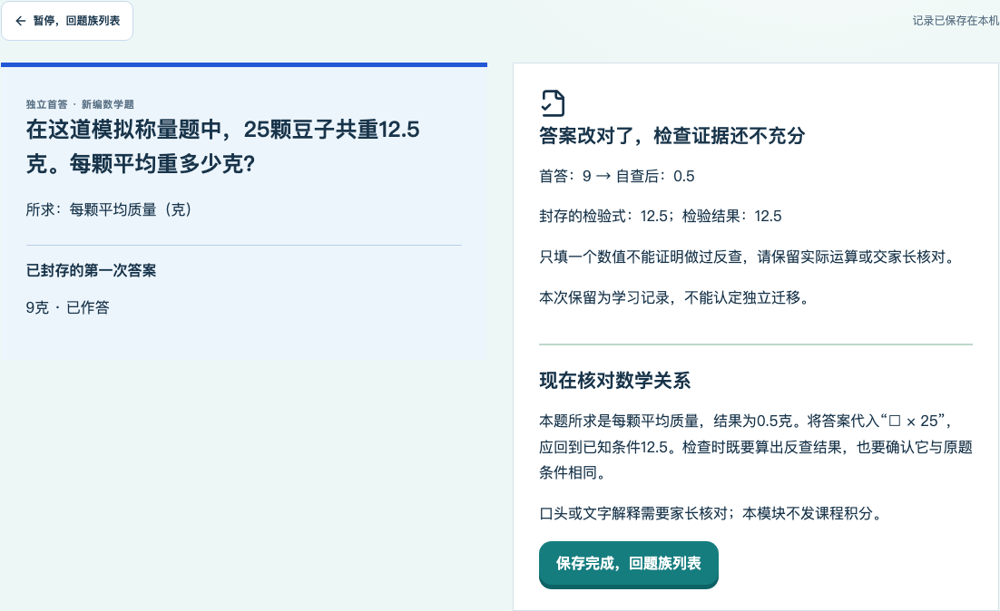
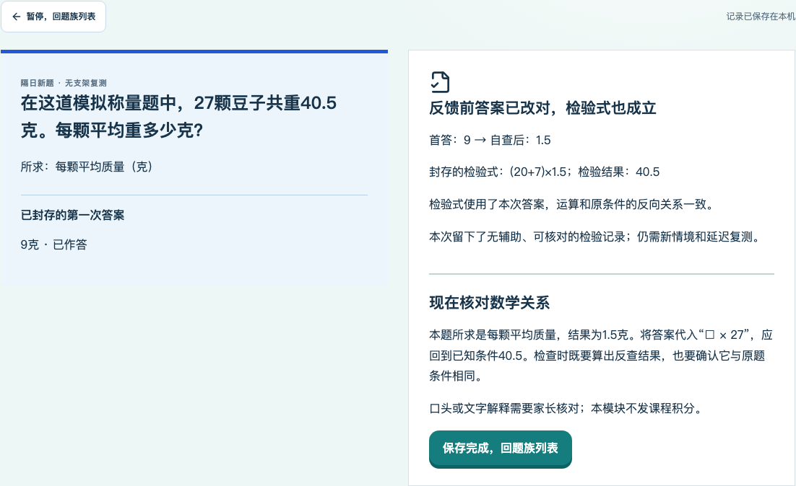
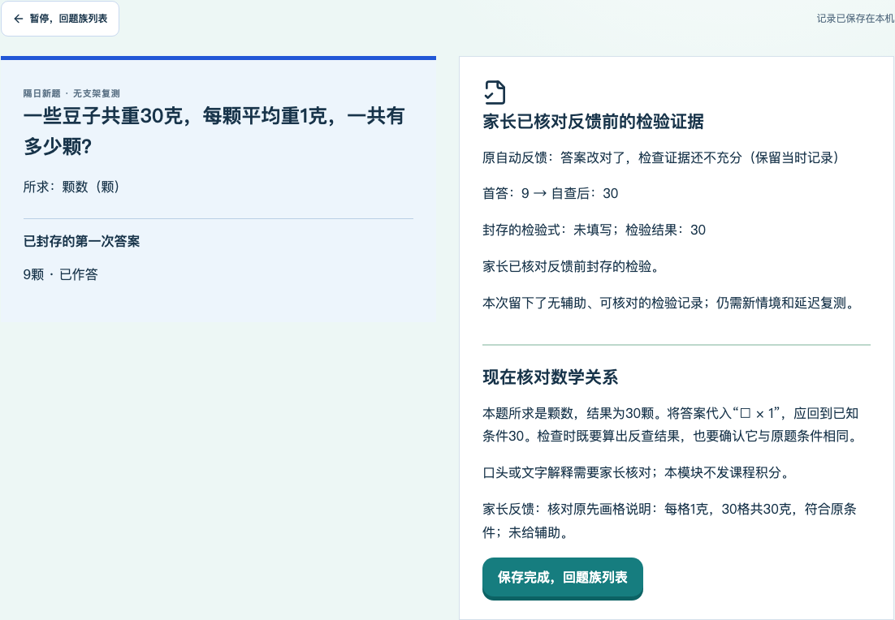
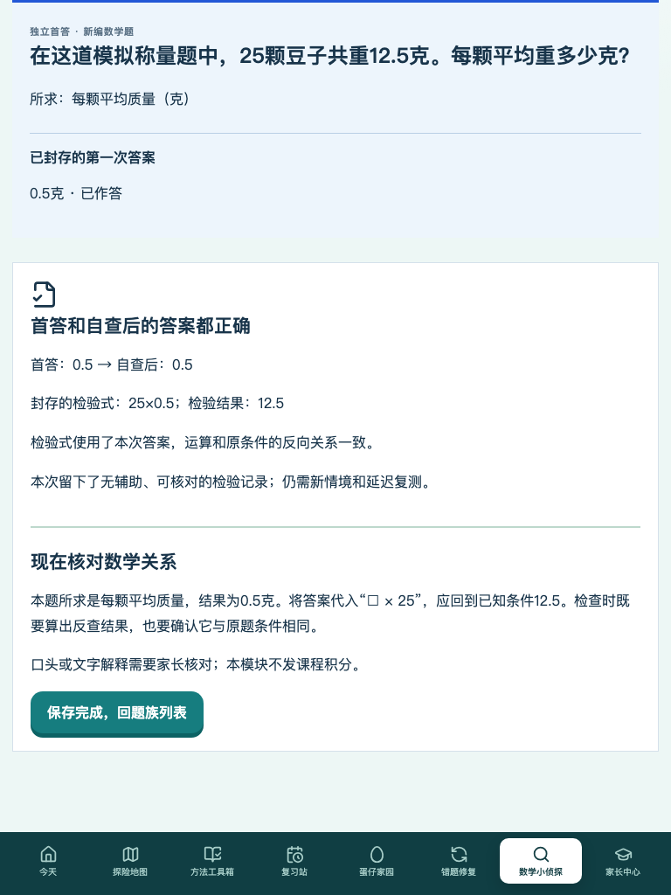

# 数学小侦探 V2：审查A/B整改与最终验收报告

> 整改日期：2026-10-28。审查基线：PR #1 `0d7fdf3e606eeae53ccbcc57f9c1887433a074c3`。
> 审查要求：[评论6443272532](https://github.com/lovestream/math-learning/pull/1#issuecomment-6443272532)。
> 本轮全量受测实现：`037d8124ab04d4c07a71dbdd1634bd3242ead386`，开始验收时工作区干净。
> 匿名投递案例分支固定对象：`8a9bd699ba88385e9336590fe70a8b3ecec4bd85`（30案），不是Kevin真实数据。
> 运行代码已完成全量隔离验收；最终归档提交仅报告及证据，PR保持Draft，未合并或切换正式服务。
> 所有作答均来自OS临时库中的匿名模拟，不代表Kevin的真实作答或掌握；没有操作真实学习数据库，没有执行正式Mac/NAS切换或合并main。

## 1. 本轮结论与范围

本报告替代上一轮交付结论，统一报告审查A、B的整改及全量回归；上一轮源代码和证据目录保留为历史，不给旧截图更换SHA。数学小侦探四层、原四步、70课849题、六步课堂、三项自查、钱包、宠物与原每日三案边界保留。没有扩展学习习惯、成长奖励、英语或统一学习家园。

数学关系核验、家长核对和孩子真实掌握是不同证据。自动程序证明的是已封存运算记录符合当前条件，不能证明孩子的心理过程、是否抄过整条算式或长期掌握；本轮不把技术通过说成Kevin已经学会。

## 2. 审查问题与最终行为

|项目|原行为|最终行为|关键实现与不变量|
|---|---|---|---|
|A：只抄核对值|普通practice/transfer的核对结果与公开目标相等即可能授予独立|所有模式都保存实际检验式；只有数值/勾选不授予独立。答案改对与有效检验分开统计|detective-check-evidence、self-store、SelfTraining；首答/二答仍先封存再反馈|
|B：拒绝等价写法|review只接受唯一标准字符串|精确安全解析，按代入后的数学函数关系核验；支持交换、括号、分配、分数与另一反向方法|不因字符串不同拒绝，也不因结果碰巧相同就放行|
|其他合理方法|家长备注不能形成有效复测证据|保存待核对；家长核对反馈前原记录后，可追加确认当前资格，最新待核对复测至多推进一次|原自动result、首答、二答、反馈时间和检验原文完全不变|
|旧版薄弱记录|旧result.independent可能沿用弱判定|旧快照按旧规则验证保存；当前资格另用新策略核对，不自动继承弱证据|不清空原成果、次数或历史答案；不静默改写旧判分|
|儿童措辞|家长确认后仍可能只看到旧的“证据不足”标题|当前显示“家长已核对反馈前的检验证据”；原自动反馈单列保留|不能把人工确认伪装成原先自动通过|

## 3. A：实际检验与答案改对分开

普通练习、迁移和延迟复测都使用`selfCheckActions.expression`保存实际检验式。儿童仍在同一个自查页面填写，没有新增课堂步骤、单位选择或打卡。允许不会写式子的孩子保留说明和数值，先进入待核对，不强迫乱写来过关。

25颗豆子共12.5克的反例已同时进入Node和真实浏览器：首答9，二答0.5，核对结果只抄12.5、检验式和说明留空。最终答案正确，但`checkValid=false`、`independent=false`，分类为答案改对但检验证据不足；迁移标签不推进，也不能由家长凭空补认空白证据。把12.5抄进检验式或解释栏、附上单位，或只套括号也不会成为可确认的检验；家长端确认按钮与服务端共用这一条件。

统计拆为：

- `preFeedbackCorrection`：反馈前答案改对，包含辅助和待核对。
- `effectiveCorrection`：另需无辅助、明确完成检查、首答可评分，并有可验证的反馈前检验式或家长确认原先封存的独立证据。

两者分母都是完成自查的可评分首答错误次数。首答空白/不确定、帮助、第一次正确却改错仍分别记录。未到期和未做不算复测失败，不因新增自查发积分或勋章。

## 4. B：数学等价核验与边界

新增服务端核验器`server/detective-check-evidence.mjs`。只解析有限长度的数字、加减乘除、括号及`□/x`，使用精确有理数和有界有理函数运算，不执行输入。长度、token、节点、嵌套和符号运算规模均有限制。

自动通过需同时证明：输入运算结果与填写值一致、填写值对应某条审定反向条件、算式实际代入本次答案，并与审定关系作为函数等价。答案数值重复出现时一并绑定；已知条件与答案恰好同值时区分数学角色，避免误拒如26克÷26颗或12＋4×3。

|输入（答案为0.5）|检验结果|结论|
|---|---:|---|
|25×0.5|12.5|通过，乘法交换|
|(20＋5)×0.5|12.5|通过，括号拆分|
|0.5×20＋0.5×5|12.5|通过，分配计算|
|1/2×25|12.5|通过，分数写法|
|12.5÷0.5|25|通过，另一反向关系|
|只填12.5|12.5|不授予独立检验|
|12.5＋25×(0.5－0.5)|12.5|不授予独立检验|
|0.5×0.5×50|12.5|不能只因在该答案碰巧相等就通过|
|0.5＋12|12.5|不通过函数关系核验|

8族×256参数×2条审定反向关系，共4096条关系有自动测试，原2048组答案oracle继续保留。这些是程序审校参数，不是新增正式课程题，更不是Kevin做过的题。

完整等式、文字证明、超出有界解析器的其他方法可能不能自动证明，会原样保留待家长核对，不能因此直接判方法错误。自动支持的范围不是任意数学证明器。

## 5. 家长核对、复测与不可变历史

家长确认`check-confirmed`要求：反馈前已有封存的检验式或说明；第二次答案数值正确、首答可评分、检查已确认完成、没有记录到提示/条件图/家长帮助；家长明确勾选核对的是反馈前证据，并写具体数学关系依据。只抄数值且没有其他证据不能补认，揭示后新做的检验不能回填成过去独立。

确认只追加parentReviews。当前`currentCheckEvidence`与`currentEvidenceEligible`可以变为parent-confirmed，原`result`快照不改。旧的`explanation-confirmed`只作为备注，本身不会升级资格。标记辅助/回补后当前资格撤下，旧记录和历次更正继续保留。

只有最新待核对复测、当前阶段与原reviewStage一致且计划修订号匹配时，才推进一次；重复event幂等、重复确认不再次推进，较早记录不跳过新的复测。作答和计划均有409保护；即使批阅达到30条上限，同一已保存事件仍可安全回放，新事件拒绝且不删历史。明确回补后不重复使用旧记录重新跳关。

儿童当前标题与原自动反馈分开展示。例：原判分仍是证据待核对，后续家长确认后显示家长已核对，并保留“原自动反馈（当时记录）”。不伪造自动判对、不改首答、不发新增奖励。

## 6. 旧存档、升级与真实数据边界

题目ID及`detective-self.v1`保持不变，新增策略版本`result.checkPolicyVersion=detective-check.v2`。旧版缺少此字段的封存快照按旧规则验证，不回填新解释；当前证据资格用新规则另算。正在首答或自查的旧记录也能完成新规则提交，原首答哈希不变。

专用升级脚本实际执行`0d7fdf3`程序：建立旧弱判分、有效旧复测与未完成首答；升级后只读检查原库逐字段相等，旧弱记录不自动授予现行独立资格；完成旧未结题、新家长确认与备份恢复；再用升级前完整检查点回滚到旧程序。另两套原有升级演练继续执行。另有专项真实旧程序反例：旧版把1×26误拒为非标准的26×1，新版只读重核其当前资格，家长确认修复最新复测阶段；原先false判分仍保留，重复事件不重复推进，备份恢复与旧检查点回滚均通过。

所有目录均由脚本在OS临时目录新建。未传入项目真实data、未操作真实PIN、未运行正式启停命令、未合并main、未修改kevin-learning-home或NAS。回滚必须同时使用升级前检查点，不能让旧判分程序继续写新版活跃库。

## 7. 验收矩阵与实际结果

|验收|测试代码/证据|实际结论|
|---|---|---|
|A抄目标＋空说明，practice/transfer|detective-evidence-review.test；evidence-browser截图|只算答案改对，独立分子0，家长不能凭空补认|
|A真实计算、辅助、空白/不确定|新13项与原V2测试|无提示实际检验有效；辅助不升级；首次状态保真|
|B交换、括号、分配、分数、代入与多方法|4096关系与具体等价式反例|函数等价接受，不用唯一标准字符串|
|B凑结果、裸数字、乘零/抵消、非法输入|精确反例与安全解析边界|不凭同值通过；保留待核对，不执行文本|
|B家长确认与更正|新Node＋真实双标签浏览器|当前资格可确认，首答/二答/反馈不变；409不覆盖；一次推进|
|旧快照/旧未结题|三套实际旧代码升级/备份/回滚|原记录不重写；旧弱证据另核对；完整检查点可回滚|
|泄题、来源blob、三视口/键盘|boundaries、evidence-keyboard、两组V2浏览器|私有引擎不进客户端，首答/自查无提前反馈；390/768/1440与200%缩放可用|
|原有课程、题库、判案与投递|全量Node/浏览器/内容检查/live deliveries|252项Node、31组本地浏览器、70课849题内容检查、30案在线回放全部通过|
|本轮同SHA CI|[pull_request CI 40603776440](https://github.com/lovestream/math-learning/actions/runs/40603776440)、[push CI 40603761603](https://github.com/lovestream/math-learning/actions/runs/40603761603)|push与PR两次同SHA CI均success，包含关键浏览器回归和产物上传|

全部报告与截图绑定受测实现SHA；最终只增报告/证据的提交由runtime-tree指纹核对同一可执行代码。最终PR HEAD及其CI链接在PR唯一交付总结中列出，不能把中途取消的旧运行算作通过。

## 8. 审查入口与复现

主要改动：

- 服务端数学证明、判分/现行资格、家长确认、旧快照校验：detective-check-evidence.mjs、detective-self-store.mjs、detective-self-questions.mjs、detective-self-integrity.mjs、shared/detective-self-validation.mjs。
- 儿童/家长页面与类型：SelfTraining.tsx、ParentSelfTraining.tsx、self-api.ts。其余70课849题、src/studio、public与真实data路径无diff。
- 测试与CI：detective-evidence-review.test.mjs、原V2测试、evidence-browser/keyboard/upgrade、原V2 browser/upgrade/boundaries、run-browser-ci与verify.yml。
- 儿童/家长说明与只读迁移契约已同步更新；完整差异清单、文件hash、矩阵、日志、截图和trace见新证据清单。

```sh
npm ci
npm test
npm run build
npm run content:check
node scripts/run-browser-ci.mjs --full
node scripts/verify-detective-deliveries.mjs
node scripts/verify-detective-evidence-keyboard.mjs
npm run test:detective:upgrade
node scripts/verify-detective-v2-upgrade.mjs
node scripts/verify-detective-evidence-upgrade.mjs
node scripts/verify-detective-v2-boundaries.mjs
node docs/review/evidence-detective-v2-review-ab-20261028/verify-legacy-equivalence.mjs
```

浅克隆须先fetch工作流固定的旧SHA，包括0d7fdf3。所有验收脚本自行建立临时库；在线投递测试需读取匿名数据分支固定Git对象，网络不可用不能冒称在线通过。

手动隔离查看（依赖与构建完成后）：

```sh
kevin_demo_dir=$(mktemp -d /tmp/kevin-detective-evidence-demo.XXXXXX)
node server/index.mjs --port=4188 --data-dir="$kevin_demo_dir"
```

打开`http://127.0.0.1:4188/?view=detective`。家长在该临时库另设PIN，不导入真实备份。Ctrl+C关闭演示；此命令不是正式服务切换。

## 9. 未解决问题与排除范围

本轮A/B任务范围内未保留已知待实现项。机器无法证明的其他方法仍需家长核对原证据，这是明确的判分边界；模拟触控不等于实机iPad，自动测试不等于Kevin真实掌握。

正式部署、真实亲子试学、新账户/长期平台重构、学习习惯、成长积分、宠物兑换、英语与统一学习家园不在本轮执行范围。PR保持Draft、不合并main、Issue #3保留待独立复审。

## 10. 本轮实际截图








