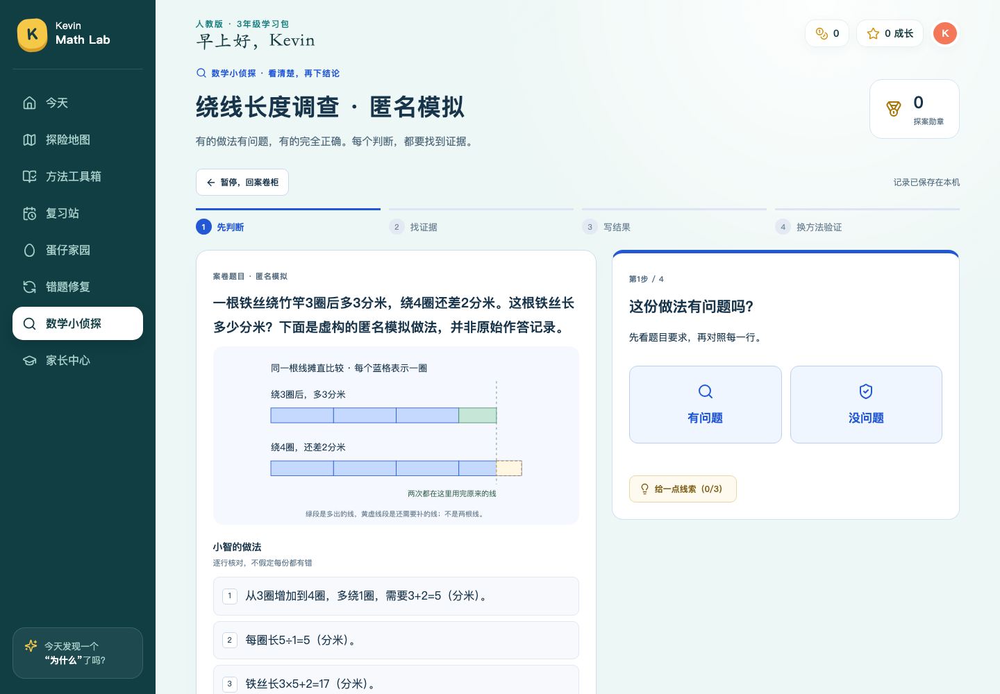

# 数学小侦探：独立审查整改验收（2026-10-16）

针对[独立审查清单](数学小侦探_独立审查意见与Codex整改清单_20261016.md)，从PR #1 `95951d7b7e9739650bacf54e62f942ec2ba874a5`继续，未误用旧main。按使用者最新要求，长期容量/归档/统一Learning Website架构暂缓，不扩建数学或英语网站。

功能提交：**`041f0e0410efae6f8fe4397addf4e6d0af9d11bb`**。独立投递审校工具补修：**`f81796d67e5873328dcbc3a615eb2ecf08d126e3`**（只修工具默认启动的变量遮蔽及验收描述，不改运行时教学代码）。本报告及截图是后续纯证据提交。

## 整改对照

|事项|原行为→目标/实际结果|实际文件与验证|状态|
|WIRE-CASE|历史草稿误写缺原题→题意完整、仅缺原始计算过程；模拟另立新案|`seed-cases.mjs`、`detective-store.mjs`；仅完整指纹匹配且未编辑/未发布的系统草稿可更正文案，家长编辑及历史不变|已修|
|WIRE-CASE|五模板不支持绕线→独立第六模板，不冒充卡片/等组|`shared/detective-inbox.mjs`、`scripts/lib/detective-delivery-audit.mjs`、三案JSON；参数族144组、恶意输入拒绝、浏览器四步|已修、已投递|
|DUP-CARDS|今日与新到直接各自渲染→按案号＋版本仅显示一次|`detective-presentation.mjs`、`DetectivePanel.tsx`；API保留完整收件库存，去重只作用于儿童展示；新活动版本不因旧版本在今日而消失|已修|
|REAL-DEPLOY|只双击启动不代表更新程序→固定旧程序生成存档，实际启动新/旧服务演练|`verify-detective-upgrade.mjs`、安全升级说明、CI步骤|隔离预演通过；真实切换待使用者确认|
|升级兼容|旧程序已收过的未知模板可能永远被blob/ETag跳过→旧oracle待审回执重新数学核验|`detective-inbox-store.mjs`、`detective-inbox-sync.mjs`；v1旧存档可读，新验证v2，已编辑/审核/撤回案不覆盖|已修|
|LONG-RETENTION|容量与长期归档|按用户指示暂缓，所有容量上限保留，不调大常量，不改真实库|明确延期|
|MODEL-COVERAGE|复杂图形尚无可靠通道→列明提取条件与确定性验证路线|[后续题型台账](../design/数学小侦探_题型覆盖后续台账_20261016.md)|本轮只实现绕线；其它候选未宣称支持|

未新增课堂步骤，三年级**70课、849正式任务、六步课堂、三项自查**不改；没有改积分/宠物规则、没有合并main或数据分支。

## 铁丝三案：数学与出处

数据分支提交 **`0559f6f9a5e6027cd1b154171e22558e26308951`**，新文件 `content/detective/inbox/DT-20261016-WIRE-A.json`，Git blob **`e00e2ac22b5d7a263c389a92866a44630e5b442c`**。程序分支另存完全相同的审定副本 `content/detective/reviewed/DT-20261016-WIRE-A.json`，未改原五包。

|案|条件|匿名模拟做法|首错/正确|正确总长|另一路验证|
|---|---|---|---|---:|---|
|A 原关系|绕3圈多3分米，绕4圈差2分米|先算一圈5分米，再误加2得17|第3行|18分米|(18＋2)÷4＝5；18−3×5＝3，4×5−18＝2|
|B 换情境|绳绕线轴2圈多4分米，3圈差2分米|先算一圈6分米，再误加2得14|第3行|16分米|(16＋2)÷3＝6；16−2×6＝4，3×6−16＝2|
|C 正确对照|绕4圈多2分米，5圈差4分米|一圈6分米；4×6＋2＝26|无错，不圈假错行|26分米|(26＋4)÷5＝6；26−4×6＝2，5×6−26＝4|

每案明确声明“虚构的匿名模拟做法，并非原始作答记录”；`simulatedSteps=true`，没有推断孩子原来如何算出17。历史草稿不直接开放，也不被新案替代。原题、提示、首错、修复/逆查、单位、条件图由同一参数契约产生；儿童首判前无标准答案/首错字段。

数学不变量：设圈数a＜b，多出s、缺少t，每圈C、总长W，必须同时满足 **W−aC＝s、bC−W＝t**。参数族含不同圈差、1～4圈起点、3～8分米一圈及正误对照，共144组。运行时求解与发布审校分开：后者枚举有限整分米圈长、逐一检验两条件唯一成立，不直接复制生成器答案。非整数解、等圈/反向圈数、越界、额外字段、错误场景/答案/图/首错被拒绝。

图将同一根线摊直、两种绕法对齐：蓝格每格一圈，绿色为多出，黄色虚线为缺少；两行原线用完的端点一致，图不额外标出未知总长。

## 展示去重与版本证据

`visibleArrivals(today,newCases)`只隐藏今日已有的**同案同版本**，不删除服务端库存。今日已显示全部三案时不再显示一个空的新到区；历史仍可回看。新活动版本与今日旧快照并存时，新版本仍显示在新到区。单元测试验证不修改输入、首答及重复库存；浏览器实测三案仅三张卡，刷新不重复，发布新版本后四张卡，旧计划/历史/三枚勋章保持。

[390px新版本仍可见](evidence-detective-audit-20261016/detective-version-entry-390.png) · [1440px](evidence-detective-audit-20261016/detective-version-entry-1440.png)。

## 升级、备份、失败回滚：实际演练结果

[可重复步骤与家长升级说明](../数学小侦探_安全升级与回滚.md)；[逐阶段差异记录](evidence-detective-audit-20261016/detective-upgrade.json)。

1. 从固定旧SHA `1d9c681`提取旧代码并用旧构建脚本生成教材，在OS临时目录以旧业务函数生成模拟存档：完成一课、课程复习记录、42积分余额与流水、购买/喂养及宠物成长、正式练习首答1/5→提示→自查→订正2/5、5包15案及已结案调查、家长PIN。再让旧oracle接收新绕线包，实为待核对。
2. 停止旧临时服务后复制**完整临时data**及导出，实际启动新临时服务，原PIN仍能解锁。逐字段比较课程首答/进度、积分/宠物/背包、旧侦探版本/计划/调查/徽章；除未编辑系统草稿的说明更正，均不变。
3. 导入预览与完整恢复旧导出，比较进度完全一致；篡改积分但不改校验的备份被拒绝，数据库不变；学习JSON恢复不更改家长密码配置。
4. 用固定五包Git blob＋绕线包重放同步，6包均auto-published，旧oracle待审绕线升级为v2。验证只是新增/发布新训练，既有首答/版本/计划/勋章、正式课程与钱包不变。
5. 保存新版导出后，故意占用端口让新服务启动失败（非0退出）。停服恢复升级前完整副本，以旧程序启动并用原PIN解锁，导出与升级前**完全相同**。新版副本在演练回滚前保留，未把丢弃新学习当作成功。

这里的同步重放是可重复夹具，不冒充在线GitHub；下节另外执行了真实网络链路。所有模拟data、密码配置、导出、日志均限临时目录，结束清理；提交的记录只含比较结论和SHA，没有密码、Cookie、学习备份或真实个人数据。

## 最终验证与证据版本

|验证|结果|版本与范围|
|---|---|---|
|`npm test`|**196通过、0失败**|功能代码041f0e0；新增5组审计测试（含144参数情境），不把参数数当测试总数|
|`npm run build` / `npm run content:check`|通过；70课/849题|类型检查、构建、教材结构检查|
|4组侦探浏览器回归|全部通过|干净041f0e0；新增审计场景、原自动收件、原四步/家长手工备用、断网/冲突/恢复|
|`npm run test:detective:upgrade`|通过|干净041f0e0；固定旧版→新版→旧备份回滚，全部模拟数据|
|真实GitHub在线接收＋18案逐案四步|**6包18/18通过**|干净f81796d；固定数据head0559f6f；原15案＋新绕线3案，匿名DEMO不计入|
|PR CI|本报告提交后运行|新增审计浏览器已纳入默认回归（共18组），升级演练亦进CI；以PR最终head的Action链接为准，不借用上一轮结果|

四组原始浏览器记录：[新增审计](evidence-detective-audit-20261016/verify-detective-audit-browser.json)、[自动收件](evidence-detective-audit-20261016/verify-detective-inbox-browser.json)、[基础探案](evidence-detective-audit-20261016/verify-detective-browser.json)、[恢复](evidence-detective-audit-20261016/verify-detective-recovery-browser.json)。均带source SHA及dirty=false；f81796d不改变这四组所验运行时代码。

[在线18案独立复算及逐案结案](evidence-detective-audit-20261016/live-18-cases.json)：核对每包真实blob，六包均auto-published；18案四步成功、5类旧题与新绕线题有入口、错误修复不通过、首判及当天计划保留、三枚每日勋章上限、重复同步不重复建案/奖励、临时备份恢复通过；排序实际拖动和上移按钮，非直接提交排序答案。截图/trace保存在`output/playwright/`，CI artifact按最终PR head保存。

## 尚未完成及明确不在本轮范围

- **真实电脑服务未切换**，未读取/备份/迁移Kevin真实学习库、未调用真实`start.command`或`stop.command`、未使用真实PIN。GitHub内容已投递、隔离站已接收，不等于真实网站已接收；真机升级须使用者确认。
- **长期容量/归档与统一Learning Website整合延期**，按本轮明确要求执行，不作为本轮漏修项。
- 复杂空间/展开图、链环/重叠和开放应用题的任意照片自动验证仍未实现；不靠AI自报“核验通过”放开。后续候选台账已列，未扩建。
- 浏览器390/768/1440是桌面自动化视口，未声称真实iPad触控或Kevin真实试学通过。技术结案不等于无支架独立迁移或长期掌握。
