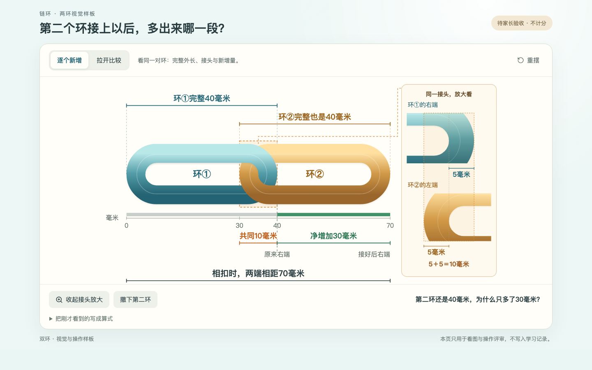
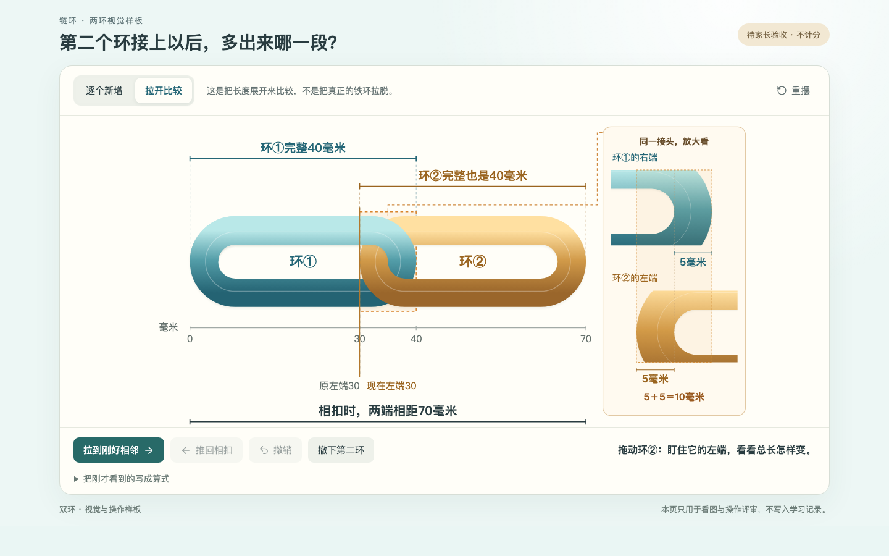

# 链环双环样板：阶段0实施与验收记录

> **2026-10-19后续确认：** 家长已批准修正标注版双环A–E。按最新§2.6，现已完成[正式课堂接入与极简多环概览](链环课堂_多环概览正式接入_20261019.md)。双环批准仅限视觉；三至五环待家长看新图。下述待审／暂停状态及旧截图保留作历史，不撤改原始证据。

> **家长复看后的标注修正：** 放大图“环①的右端”文字已移到框的最右侧虚线处。见[更新后的五张聊天截图](双环样板_端点标注修正与聊天截图_20261019.md)。下文c81ee7a截图作为阶段0历史证据保留，不冒充更新版。

日期：2026-10-19。状态：**`awaiting-parent-visual-approval`（待家长视觉验收）**。

本轮仅实现 `G3-U03-E02` 的**两个环视觉/交互样板**。依据[视觉重设计意见](链环课堂_ChatGPT视觉重设计与Codex实施意见_20261018.md)最高优先的§2.5，先看两个环，不扩至三、四环，不推广其他课程。原卡片方案仍是用户拒绝的历史实现，未因本轮测试而获得认可。

功能提交：`c81ee7a508c9df19131c3e35f5263c96e0122efb`，PR #1 `audit-fixes-20261002`。后续归档提交只更新文档与截图，功能证据绑定此SHA，不冒充每次PR head都重新截图。

## 入口和观察顺序

- 独立入口：`/?preview=chain-two`。只挂载样板，不挂载学习App，不调用学习API；刷新重新从首环开始。
- 原课“亲手实验”增加“打开双环视觉样板（待家长验收）”链接；从课内进入可返回原课。
- A：先只看第一个完整40毫米环，确认从哪一端量到哪一端，不先展示70或80的答案。
- B：点“接上第二环”。完整第二环平移接入，不伸长、不缩短；四个量同时对应原物体：首环40、第二环40、共同范围10、新增长度30。
- C→D：切到“拉开比较”，拖动第二环，盯住左端从30移到40，右端从70移到80；保留原位置虚影和位移标记。也可用按钮，或方向键/Home/End移动。
- E：点“推回相扣”，回到原来的70毫米。可撤销、重摆，不计分。

**展开是长度示意副本的比较，不是把封闭铁环真的拉脱。** 一开始移动就换成虚线副本，不画金属穿透；此时隐藏原接头的两个5毫米，防止把变化中的图示交叠误认成金属变薄。70始终是原相扣模型的答案，80只代表展开相邻的比较距离。

## 图与数学状态的一致性

|量|毫米区间/不变量|实现与核验|
|---|---|---|
|环①完整外长|[0,40]|尺寸线引至两端外缘|
|环②完整外长|相扣[30,70]；平移d后[30+d,70+d]|宽、高、粗细不变，尺寸线同步移动|
|共同范围|[30,40]，宽10|主图原位橙框与放大图同源|
|环①右端金属|[35,40]，厚5|蓝端到框的最右边|
|环②左端金属|[30,35]，厚5|黄端从框的最左边开始|
|本次净增加|[40,70]，长30|绿色对应原右端到新右端，不另画短“完整环”|
|比较位移d|0≤d≤10；0.1毫米数值精度|鼠标越界夹取，端点吸附，键盘每次1毫米|
|相扣总长|始终70|不受比较位移、撤销、重摆影响|
|比较两端距离|70+d，最多80|与相扣答案分字段，不接入评分或掌握记录|

`shared/two-ring-view.mjs`从既有`chainMeasure(40,5,2)`及`chainJointGeometry(5)`派生模型；没有修改原模型、正式答案或任务版本。主图统一毫米到x坐标映射；放大图在同一几何基础上放大并裁去远端，不压扁端部。两环同样外观比例，交错遮挡只帮助辨认相扣。算式收在按需展开中。

## 五个实际画面（1440×900）

以下均为浏览器实际渲染，不是设计稿或旧版截图。

### A：首环40毫米

### B：两个完整40、共同10、净增30同图

### C：比较起点，左端30，总长70

### D：拖到刚好相邻，左端40，比较总长80

### E：推回相扣，仍是70

## 测试与代码复查

- 全量Node：**211项通过**，包含新模型在0～10毫米间101个位置的守恒/端点检查、越界、往返与非有限输入。
- 构建：TypeScript与Vite通过。内容检查：**70课、849个正式任务**，数量、ID及本轮前的内容版本保持不变。
- 双环浏览器：五个关键状态、外长尺寸线与实际外缘、真实端部位置、放大比例、鼠标中点/终点/越界、键盘、撤销往返、完整环平移动画、减少动态效果、刷新及零学习API检查。
- 原链环专项：保留原课程行为与逆向练习回归，仅说明兼容性；旧图仍未获家长认可。
- 70课模板回归：六步课堂、三项勾选、不要求填写自查说明、不提前判分的路径保持。
- 复查修正了预览中撤销读取晚到的可变状态、全局CSS过渡造成尺寸线滞后、放大框遮住端点说明等问题。
- 浏览器测试只用OS临时目录中的模拟进度。**未读取/修改Kevin真实进度、首答、批阅、积分或PIN；未启动/重启真实学习服务。**独立静态预览只展示样板。

证据：[来源与校验清单](evidence-chain-two-20261019/manifest.json)、[双环回归](evidence-chain-two-20261019/verify-two-ring-browser.json)、[原链环回归](evidence-chain-two-20261019/verify-chain-growth-browser.json)、[70课模板回归](evidence-chain-two-20261019/verify-template-browser.json)、[干净源码记录](evidence-chain-two-20261019/source-evidence.json)。CI已包含双环专项，截图/trace按既有工作流上传；具体运行见[功能提交的CI](https://github.com/lovestream/math-learning/actions/runs/39177988131)，归档时该CI仍在运行，本报告只确认上述本地结果。

## 本轮修改文件

|文件|作用|
|---|---|
|`src/main.tsx`|隔离、懒加载样板入口|
|`src/studio/measurement/TwoRingWorkbench.tsx`|双环同图、拖动、动画、放大、撤销|
|`src/studio/measurement/two-ring.css`|电脑单屏画面与同步几何显示|
|`src/studio/measurement/ChainExperiment.tsx`|原课增加样板链接，保留原课堂状态逻辑|
|`shared/two-ring-view.mjs`及声明|比较状态与相扣答案分离|
|`tests/two-ring-view.test.mjs`|数学不变量回归|
|`scripts/verify-two-ring-browser.js`|真实浏览器、五张截图、零学习API断言|
|`scripts/run-browser-ci.mjs`|加入默认/全量CI；样板从隔离入口开始|

## 停止位置与尚未验收项

1. **家长/Kevin是否能看懂尚未验证**；技术检查不代替亲子试学。请重点看40对应哪里、两个5是否能辨认、为什么只新增30、比较位移10与原共同10的联系。
2. 原六步课堂没有被半成品强行替换。双环样板获得明确视觉认可后，才接入正式课堂并做三、四环扩展；既有四环图仍按历史未验收处理。
3. 本轮没有重做“先猜一猜”及正式逆向题配图，也未扩展其他69课、四至六年级或43张暂缓卡。已有正逆训练保留，后续接入须对应相同模型再验收。
4. 只按电脑1440×900核查新样板。没有声称手机、平板、真实设备触控或教学掌握已经通过。
5. 本地预览、PR代码和截图均可评审；未合并main，不触碰真实学习记录。
