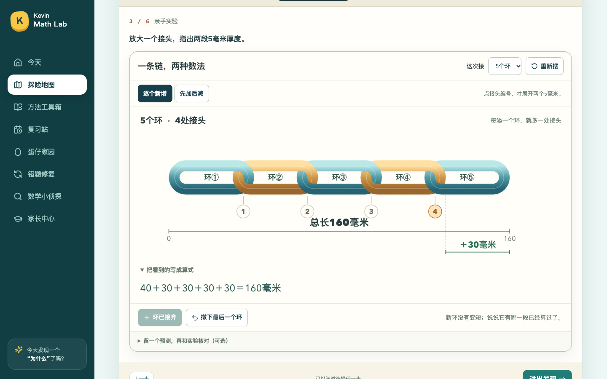
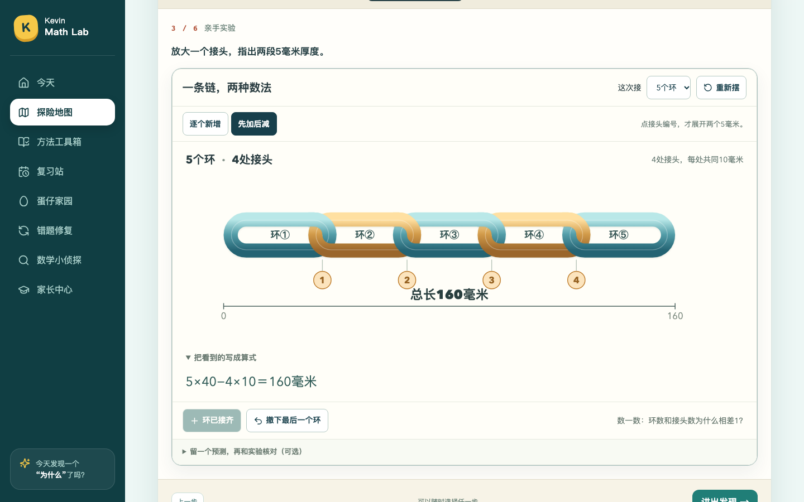
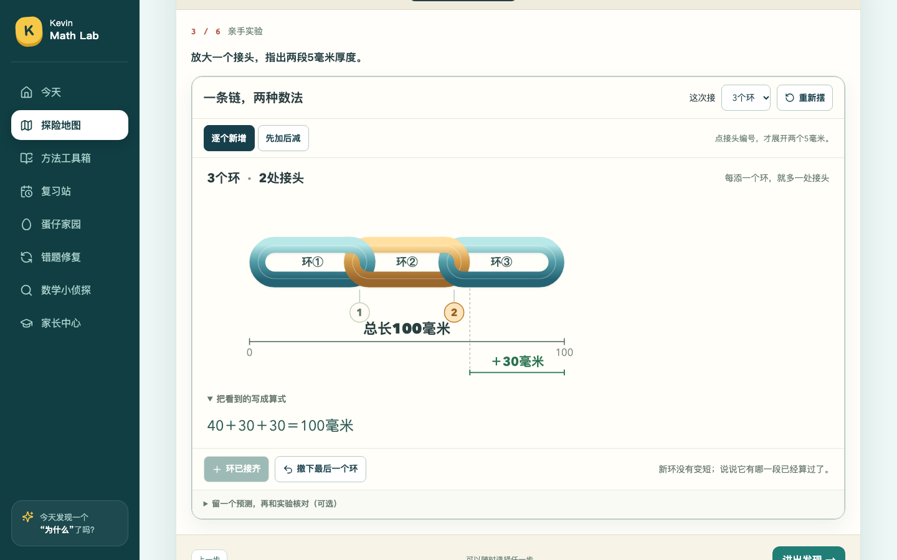
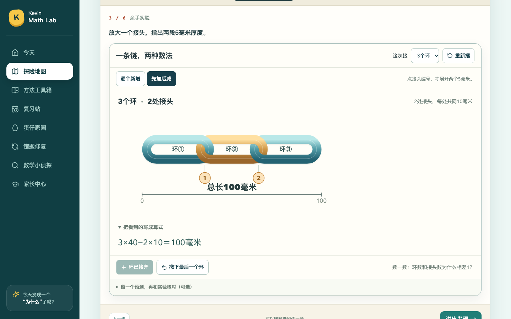
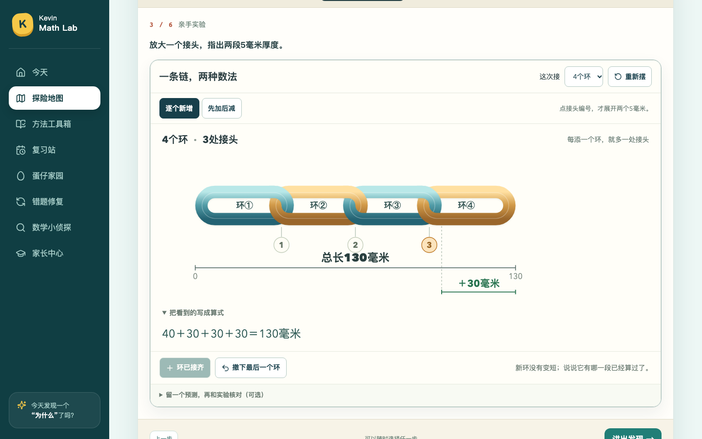
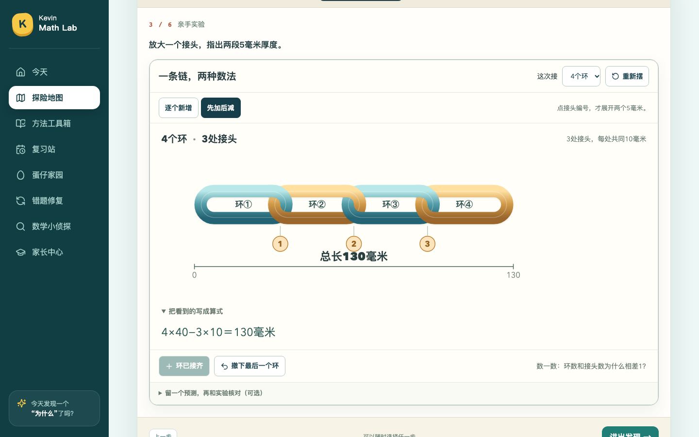
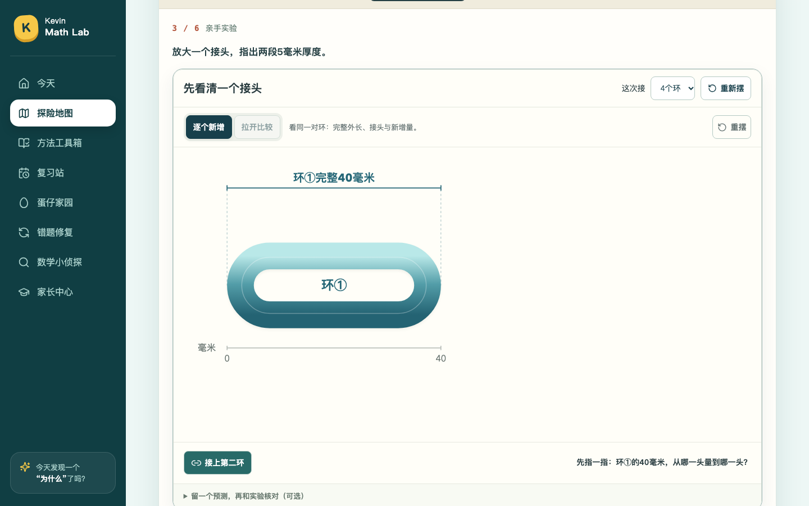
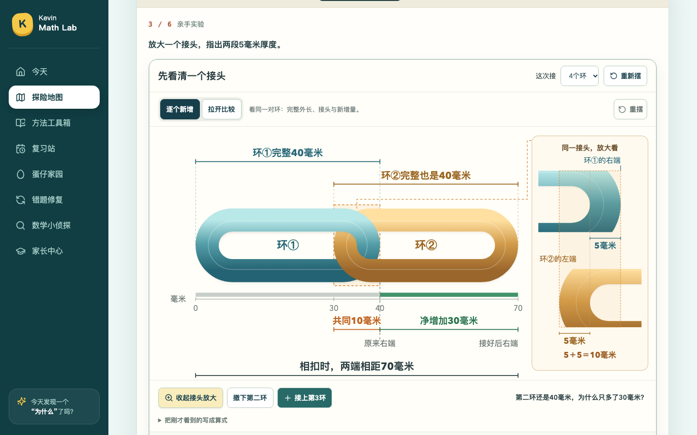

# 链环课堂：§2.6多环概览与正式接入

日期：2026-10-19。范围：**仅G3-U03-E02**。双环视觉已获家长认可；**多环新画面待家长看图**，不等于Kevin已经掌握。

本轮以GitHub设计文档新增的[§2.6](链环课堂_ChatGPT视觉重设计与Codex实施意见_20261018.md)为准，文档基线`dacc7d0`。功能提交：`948a5574aface16815c8dadbda08ed70fc0d21e4`。后续归档提交仅存报告、审批事件与截图。

## 已接入正式课堂

“亲手实验”已真正替换旧卡片，不再只放预览链接：

1. **1环**：先量完整40毫米；可点按钮或把新环拖到画面。
2. **2环**：沿用获认可的40／40／共同10／净增30、两个5毫米端部、拉开比较与推回。嵌入适配只处理外层布局、事件及保存；几何、端部位置与80比较含义保持。
3. **3～5环**：一条连续等大链、一条总长尺、接头小编号；新增法只标最新＋30；去重法只强调接头和一处统一的“每处共同10毫米”。不同时展示两套大公式、不复制各环外长卡。
4. **可选细看**：点某个接头，只出现一份原位端部特写。环序号、颜色与主链一致；关闭恢复原链，弹窗说明整链仍为当前总长，不把局部两环的70写作整链总长。

目标仍可选2～5，接环、撤下、重摆、键盘、切换算法、刷新与进度导入导出保留。公式按需展开，一次一行；可选预测核对收起，不增加课堂必经步骤。第2步继续对应原故事的4环问题，第5步保留“原故事”和“当前实验”两个明确范围；试验改为5环时，当前表达使用5环与4处接头，结果留空供Kevin口头填写。

## 数学与状态约束

|环数|接头数|相扣总长|本次净增|
|---:|---:|---:|---:|
|1|0|40毫米|首环完整40|
|2|1|70毫米|30毫米|
|3|2|100毫米|30毫米|
|4|3|130毫米|30毫米|
|5|4|160毫米|30毫米|

所有端点、接头、净增量和总长来自既有`chainMeasure()`。多环中每个完整环均为相同宽、高、粗细；与定稿双环使用同一Ring轮廓，并统一缩放。新增动画平移完整环，不把40毫米缩成30毫米。相扣长度与双环假想展开比较独立；后者80毫米不写入相扣总长、当前数学表达、积分或掌握度。

**五环两种算法：** `40＋30＋30＋30＋30＝160毫米`；`5×40−4×10＝160毫米`。切换时不重新摆环，外缘坐标与总长完全相同。

保存继续使用原有labVersion=2及旧字段，不改正式任务ID、内容版本、首答/批阅、积分或错题历史。`shared/length-model.mjs`、`shared/two-ring-view.mjs`及正式849题内容未变。旧链环状态通过验证仍原样保留；浏览器中完成新实验的导出、导入和刷新回放。

## 五环实际画面（1440×900）

### 逐个新增：只突出最后＋30

### 先加后减：4处接头，一条去重算式

### 点第4处接头：只展开环④与环⑤

## 三环、四环与课堂衔接

## 复查与证据

- 全量Node **213项通过**；包含新增法与去重法相等、接头数、净增区间、旧状态保留，以及比较80不进入当前相扣表达。
- TypeScript/Vite构建、70课／849任务内容检查通过。本轮没有改题库或其他69课内容。
- GitHub Actions已核对功能提交`948a557`的[网站验证](https://github.com/lovestream/math-learning/actions/runs/39191560535)和[另一条验证工作流](https://github.com/lovestream/math-learning/actions/runs/39191555974)均为success；本地截图来源仍绑定同一干净提交。
- **双环黄金样板回归**：独立预览A–E仍可操作。仅将双环视觉状态更新为`parent-visual-approved`；与获认可标注修正版相比，五幅图数学区域的本机像素差异均为0。对比不含应更新的审批徽标，且不宣称不同系统字体逐像素一致。
- **本课完整回归**：1→2→3/4/5、真实完整环平移动画、同尺寸及总尺外缘、两算法坐标不变、每个接头可单独查看/关闭、键盘撤下再添、刷新、导入导出、预测错误后订正、11道既有逆向/迁移任务与三项自查。探索不会自动发独立掌握积分。
- **70课模板回归**：六步导航、三项自查、无需填写反思说明、首答与最终答分开保存。
- **教具清单与17章语义回归**：链环选择器按新正式界面验证；其余路径保留原检查。
- **本课桌面完整路径**：仅用`DESKTOP_LESSONS=G3-U03-E02`，覆盖原故事、猜想、实验、复述、数学表达、练习入口及桌面宽度；没有把这一组说成重跑全部70课数学路径。
- 代理已查看本轮多环、两算法和接头特写截图。所有浏览器进度均来自OS临时目录，**未读取/修改Kevin真实学习数据、PIN、积分或真实服务**。

[证据清单与文件校验](evidence-chain-overview-20261019/manifest.json) · [浏览器摘要](evidence-chain-overview-20261019/ci-summary.json) · [双环数学画面比较](evidence-chain-overview-20261019/two-ring-golden-comparison.json) · [来源SHA](evidence-chain-overview-20261019/source-evidence.json) · [双环视觉批准事件](链环双环视觉批准事件_20261019.json)。

## 修改文件与边界

- `ChainExperiment.tsx`：正式1/2/3～5环衔接与原状态保存，移除旧外长卡和重复公式。
- `ChainOverview.tsx`、`chain-classroom.css`：单链概览、最新净增、接头焦点、可选公式与电脑布局。
- `TwoRingWorkbench.tsx`：嵌入事件、状态恢复与局部特写复用；默认数学画面不变。
- `LengthWorkbench.tsx`：只对chain分支使用新入口，其他测量课不变。
- 本课数学/旧状态测试、链环浏览器与既有教具/语义驱动同步到新界面；关键路径已处于现有PR CI范围。

**尚待确认：** 家长查看本轮多环画面；Kevin实际试学时能否解释“5环4接头”和两种数法。双环批准不再重问，多环实现不自动获得教学批准或学生掌握标记。四至六年级、其他69课及43张暂缓卡不在本轮修改范围；未合并main。
