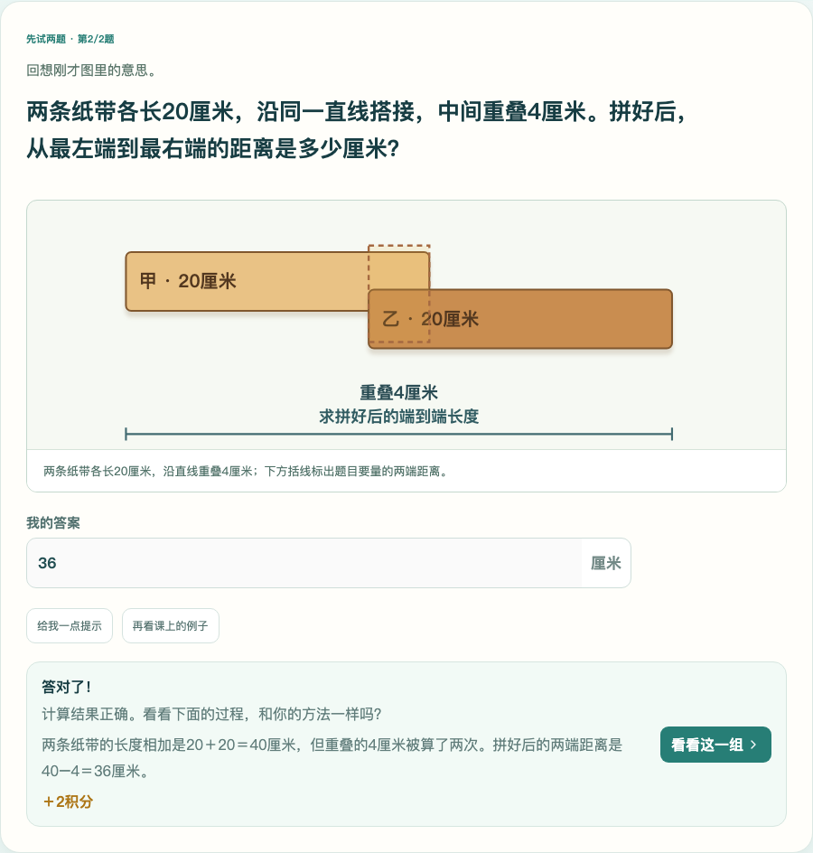

# 纸条重叠题与类似歧义：修订及验收

## 结论

用户按“重叠后有多长”理解并算出36厘米，是合理的。原题“两张纸各20厘米，重叠4厘米。材料总长是多少厘米？”却以40为答案，实际想考两条原材料各自长度的和；题意没有明确这一区别，容易把理解正确的孩子判错。本轮确认是出题表述问题，不归咎于孩子。

现改为：**两条纸带各长20厘米，沿同一直线搭接，中间重叠4厘米。拼好后，从最左端到最右端的距离是多少厘米？**

本问明确判 **20＋20−4＝36厘米**。图中两条各200毫米，重叠40毫米，括线标出拼后的最外两端；提示、解释与图一致。40仅是两条各自长度之和，不再冒充本问的答案。没有把36和40同时设为正确答案掩盖歧义。

## 本轮复核范围

基线：PR #1 `22ae204a13b17ec7ef10692a4fd5c109df66c135`。

筛查三年级70课、849个正式任务；根据重叠/搭接、隐含前题引用、至少/最多与容量、时间、总长/全长/剩余等问法，选出**115个不重复任务逐条核读**，并检查相关题图和解释。关键词只用于找候选，不算语义证明；本轮没有声称把全部849题重新做了一遍独立人工教学审批。

共修订**29题**：只有 `G3-U03-E01.w2` 改变所求量与评分答案（40→36）；其余28题补清问法或连接条件，数学答案保持。另3题本身未改，随同课评估版本升级。每题前后题干、答案、指纹、版本和具体审校理由见[逐题台账](题意歧义审校台账_20261017.json)。

|类别|修订内容|
|---|---|
|纸带/木板/绳子搭接|明确问拼后最左端到最右端的距离；多段题说明沿直线、只在相邻段重叠、没有三重重叠；“每处2厘米”明确为重叠长度|
|链环|去掉“这样的”“同一模型”“答案130”等依赖前题的表述；单题写足外长、厚度、两端部重叠、不首尾闭合及所量外缘|
|钟面间隔|明确从12出发，经过所有数字再回到12，问整圈12个间隔，避免理解为任意相邻两数之间的1个间隔|
|贴边拼图周长|明确求拼成图形的外周长，才从两块原周长的和减共同边的两倍；不与纸带覆盖长度只去重一次混用|
|两家买纸|改问各自包数、花费、余纸，以及是否有一家更便宜；允许判断两家同为24元，不在问法中暗示必有便宜的一家|
|不同人数与速度|两组合并明确每人只数一次；给齐统计活动范围；返回速度题明确同一路程、平均每小时走多少千米|

未发现上述筛选范围内需要再改数值答案的第二题；这不等于保证其余未重新逐题核读的题目永无歧义。其他课程或真实试学反馈仍需按具体问题复核。

## 图示修正

- 原纸条题补对应条件图；五条、六条搭接的迁移/复习题也补图，未知重叠或未知环数的逆向题不偷画出答案。
- 木板图原固定230高度，会裁掉多段底部标注；改为按材料段数计算图高和尺寸线位置。
- 实际看图发现：普通练习页原本缺重叠区样式，SVG默认画成不透明黑块，挡住材料文字。把透明填色和虚线边框放到通用测量样式，课堂和直接进入练习均可读；浏览器验证透明度及图形边界。

[390px纸条题](evidence-question-clarity-20261017/clarity-paper-question-390.png) · [五段搭接](evidence-question-clarity-20261017/clarity-5-pieces-390.png) · [六段搭接](evidence-question-clarity-20261017/clarity-6-pieces-390.png)。这些是临时测试站截图，不是Kevin真实进度。

## 版本、首答与积分

`G3-U03-E01`评估版本升级为`2026-10-17.1`，任务ID不变。旧题的首答、帮助、勾选、原判定保留，不暗中改写历史。重新打开课程创建新版练习，按明确题意评分；旧页面继续提交旧版本的这一题会收到“题目已经更正，请重新打开本课”的说明，不能再按旧40继续判错。

自动测试分别构造旧首答36和40：旧记录不被覆盖，新36正确；旧40曾领过该任务奖励时，新版不重复发奖。导出、导入仍保留旧、新会话。测试只用临时对象/数据库，没有读取或修改Kevin真实学习库。

原六步课堂、三项勾选自查、70课/849任务、任务ID和奖励规则保留；四至六年级、43张暂缓卡、数学小侦探及长期Learning Website整合均不改。

## 文件与验证证据

- `content/pilot/length-measurement.mjs`：搭接、链环、钟面源题及配图；`clarity-errata.mjs`：其它九题的明确问法及修订标识；`source.mjs`：版本与编译；已同步`lessons.json`。
- `server/pilot-store.mjs`：这一已更正任务的旧页面评分保护。
- `shared/task-audit-oracle.mjs`：独立题图核验识别明确的最外两端距离，不把接头数或逆向未知量当总长。
- `TaskDiagram.tsx`、`measurement.css`：多段图高度及透明重叠区。
- `semantic-notes.mjs`、`independent-relations.json`、849题登记和70课台账：只针对本轮审定内容续签，保留原始快照及审阅边界。原来20＋20＝40的关系已换成20＋20−4＝36；499条独立有理数等式仍全部成立。
- `tests/question-clarity.test.mjs`：新增5组回归，含毫米位置并集独立复算、36/40区分、上下文、旧版本、重复奖励、备份兼容与29题修订边界。
- `scripts/verify-clarity-browser.js`已加入PR默认CI，关键浏览器回归现在19组；升级/恢复演练继续保留。

最终功能代码：`fdcaaad2f4ab3430e87a64c95d6b449b93cb7e02`；看图后的透明样式补修：**`c440e99b36ab8387dd2dba5fec611c122a20cf9a`**。

本地验证：**201项Node测试通过，构建/类型检查、content:check通过（70课/849题）**。在干净`c440e99`上跑通纸条36答对、三项自查、首答保存、刷新不重复奖励、五/六段图完整、链环独立条件和钟面整圈；[浏览器结果JSON](evidence-question-clarity-20261017/verify-clarity-browser.json)带SHA和dirty=false。开发阶段另跑原题库回归、70课六步模板回归通过；最终完整CI以PR当前head的Action结论为准，不把旧CI冒充本轮。

本报告追加提交只存证据，不改变已测试功能。没有合并main，没有重启真实学习服务；程序更新和真实服务切换仍按既定安全升级流程执行。历史电脑课堂/模型证据只有内容未变且题库新审校匹配时才复用，不把本轮题意修订称为新的Kevin掌握证明。
